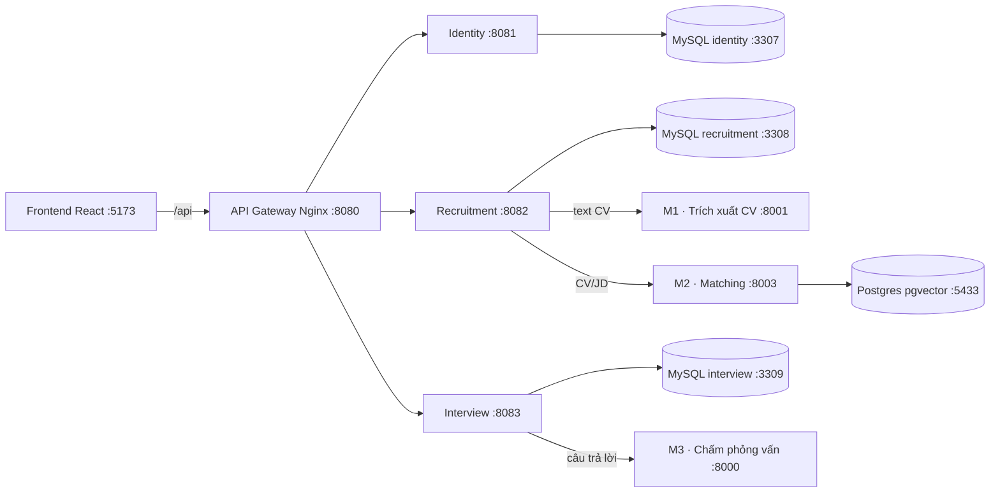

# HireLens

Hệ thống hỗ trợ tuyển dụng: ứng viên tải CV, hệ thống tự trích xuất hồ sơ (Module 1), đối sánh CV ↔ việc làm (Module 2) và luyện phỏng vấn có chấm điểm (Module 3).

Tài liệu này hướng dẫn **chạy toàn bộ hệ thống trên máy local**, từ phần lõi (backend, database, frontend) đến các service AI.

---

## 1. Kiến trúc và cổng



| Thành phần | Thư mục | Cổng local | Chạy khi |
|---|---|---|---|
| Frontend (React, Vite) | `frontend/` | 5173 | luôn |
| API Gateway (Nginx) | `infra/gateway/` | 8080 | luôn |
| Identity Service: tài khoản, JWT | `backend/identity-service/` | 8081 | luôn |
| Recruitment Service: CV, việc làm, ứng tuyển, gọi M1/M2 | `backend/recruitment-service/` | 8082 | luôn |
| Interview Service: phiên phỏng vấn, chấm | `backend/interview-service/` | 8083 | luôn |
| 3 MySQL (mỗi service một database) | – | 3307 / 3308 / 3309 | luôn |
| **M1 · Trích xuất CV** (Qwen3-1.7B v4, llama.cpp) | `ai-service/extraction/` | 8001 | profile `cv-ai` |
| **M2 · Matching CV ↔ JD** (bge-m3) + Postgres | `ai-service/matching/service/` | 8003, 5433 | profile `match` |
| **M3 · Chấm câu trả lời phỏng vấn** | `ai-service/interview/service/` | 8000 | profile `ai` |

Các cổng service và database chỉ mở trên `127.0.0.1`. Frontend gọi `/api` qua proxy của Vite tới gateway `:8080`.

---

## 2. Yêu cầu

| Công cụ | Phiên bản | Dùng cho |
|---|---|---|
| Docker Engine + Docker Compose v2 | mới | chạy toàn bộ backend, database và AI |
| Node.js + npm | 20+ | frontend |
| Python | 3.11+ | tải model (`gdown`), script kiểm tra; chạy AI ngoài Docker |
| JDK | 17 hoặc 21 | chỉ khi chạy backend Java ngoài Docker (JDK 25 chưa build được module `common`) |

Dung lượng trống nên có **≥ 15 GB**: image Docker, model M1 (~1,1 GB), model bge-m3 của M2 (~2,3 GB), cache Hugging Face của M3.

---

## 3. Chuẩn bị (làm một lần)

### 3.1. File cấu hình `.env`

```bash
cp .env.microservices.example .env
```

Sửa trong `.env`:

```bash
# Thư mục lưu database, file upload, cache model. Giá trị mẫu trỏ tới máy khác: ĐỔI về máy bạn.
STORAGE_ROOT=/đường/dẫn/tới/recruit_system/data/runtime

# Khoá HMAC cho Module 2 (bắt buộc khi bật profile match). Tạo ngẫu nhiên, không commit:
CVMATCH_HMAC_KEY=<kết quả của: openssl rand -hex 32>
```

Các giá trị khác (`DB_PASSWORD`, `JWT_SECRET`, `SERVICE_TOKEN`…) để mặc định khi chạy local; đổi trước khi triển khai ra ngoài.

### 3.2. Tạo thư mục lưu trữ

Docker Compose gắn dữ liệu vào các thư mục con của `STORAGE_ROOT`; các thư mục này phải tồn tại trước:

```bash
source .env   # hoặc export STORAGE_ROOT=... thủ công
mkdir -p "$STORAGE_ROOT"/{mysql/identity,mysql/recruitment,mysql/interview,uploads,interview-huggingface,interview-output,postgres/cvmatch,cvmatch-huggingface}
```

> `backend/scripts/setup-storage.sh` chỉ dành cho máy có ổ `/run/media/long/DATA`: script này di chuyển thư mục dữ liệu của Docker/containerd toàn hệ thống. **Không cần và không nên chạy** trên máy khác.

### 3.3. Model cho Module 1 (trích xuất CV)

Trọng số không có trong Git. Tải file GGUF v4 (~1,1 GB) về đúng chỗ Docker Compose mount:

```bash
python3 -m pip install --user gdown
mkdir -p ai-service/models/cv-extraction
python3 -m gdown 1mKd0SmhnUKpJTXkH3xQs0puEwYgqFQWn -O ai-service/models/cv-extraction/model-v4-q4_k_m.gguf
```

Tên file phải đúng `model-v4-q4_k_m.gguf` (khớp `CV_MODEL_VERSION=v4` trong `.env`).

Module 2 và Module 3 tự tải model từ Hugging Face ở lần chạy đầu; KB snapshot của Module 2 đã có sẵn trong `ai-service/matching/kb-builder/out/snapshot/`.

---

## 4. Chạy phần lõi (chưa có AI)

```bash
docker compose up -d --build
docker compose ps        # chờ identity/recruitment/interview chuyển sang healthy (~1–2 phút)
```

Frontend:

```bash
cd frontend
npm install
npm run dev
```

Mở `http://localhost:5173`. Tài khoản có sẵn (mật khẩu `demo1234`):

| Vai trò | Email |
|---|---|
| Ứng viên | `candidate@hirelens.local` |
| Nhà tuyển dụng | `recruiter@hirelens.local` |
| Quản trị | `admin@hirelens.local` |

Ở bước này đăng nhập, tạo việc làm, quản lý tài khoản đã dùng được. Tải CV, matching và chấm phỏng vấn sẽ báo lỗi **"AI chưa sẵn sàng"** cho đến khi bật các service AI ở bước 5 (hệ thống không trả dữ liệu mẫu).

---

## 5. Bật các service AI

Mỗi module AI là một profile của Docker Compose, bật riêng hoặc cùng lúc:

```bash
# cả 3 module
docker compose --profile cv-ai --profile match --profile ai up -d --build
```

| Profile | Module | Lưu ý |
|---|---|---|
| `cv-ai` | M1 · Trích xuất CV | Cần file GGUF ở bước 3.3. Image chạy llama.cpp trên **CPU**: mỗi CV ~30–60 s. Muốn nhanh hơn dùng Colab GPU (mục 5.1) |
| `match` | M2 · Matching | Cần `CVMATCH_HMAC_KEY`. Lần đầu tải bge-m3 (~2,3 GB), service có thể mất tới ~10 phút mới healthy. Có NVIDIA GPU: thêm `-f docker-compose.yml -f docker-compose.gpu.yml` |
| `ai` | M3 · Chấm phỏng vấn | Lần đầu tải model BERT từ Hugging Face |

**Lần đầu bật `match`** (hoặc sau khi đổi `CVMATCH_HMAC_KEY`, đổi KB, mất volume): nạp lại CV/JD đang có sang Module 2:

```bash
source .env
curl -X POST -H "X-Service-Token: $SERVICE_TOKEN" "http://127.0.0.1:8082/internal/cvmatch/backfill?scope=all"
```

### 5.1. Module 1 trên Google Colab GPU (tuỳ chọn, nhanh hơn CPU ~10 lần)

1. Mở [`ai-service/extraction/serve_on_colab_gpu.ipynb`](https://colab.research.google.com/github/long20102004/recruit_system/blob/dev_hocnv/ai-service/extraction/serve_on_colab_gpu.ipynb) trên Colab → Runtime → **T4 GPU** → **Run all**.
2. Cell [6] in ra URL dạng `https://….trycloudflare.com`.
3. Trong `.env` đặt `CV_EXTRACTION_URL=<URL đó>` rồi tạo lại Recruitment Service (không cần bật profile `cv-ai`):

   ```bash
   docker compose up -d --force-recreate recruitment-service
   ```

Tương tự, `CVMATCH_URL` trỏ Module 2 sang máy khác (cần cùng `SERVICE_TOKEN` ở hai phía).

---

## 6. Kiểm tra hệ thống

```bash
curl -s http://127.0.0.1:8081/health      # identity
curl -s http://127.0.0.1:8082/health      # recruitment
curl -s http://127.0.0.1:8083/health      # interview
curl -s http://127.0.0.1:8001/health      # M1: "engine":"llama_cpp", "prompt_version":"v4" khi model đã nạp
curl -s http://127.0.0.1:8003/health      # M2
curl -s http://127.0.0.1:8000/health      # M3
```

Kiểm tra đầu cuối qua gateway (đăng nhập, upload CV, xác nhận hồ sơ, matching, xếp hạng):

```bash
python3 backend/scripts/smoke-stack.py                         # dùng CV có sẵn của ứng viên demo
python3 backend/scripts/smoke-stack.py --cv /abs/path/CV.pdf   # chạy cả Module 1 với một CV cụ thể
python3 backend/scripts/smoke-stack.py --no-matching           # khi chưa bật profile match
```

Gọi trực tiếp Module 1 với text CV:

```bash
curl -s -X POST http://127.0.0.1:8001/api/v1/extract-cv \
  -H 'Content-Type: application/json' \
  -d '{"cv_text":"NGUYEN VAN A\na@example.com\nSKILLS\nJava, Spring Boot"}'
```

---

## 7. Chạy từng phần ngoài Docker (khi phát triển)

### Backend Java

```bash
docker compose up -d identity-db recruitment-db interview-db
cd backend
JAVA_HOME=<JDK 17 hoặc 21> ./mvnw clean package
java -jar identity-service/target/identity-service-0.0.1-SNAPSHOT.jar        # terminal 1, :8081
java -jar recruitment-service/target/recruitment-service-0.0.1-SNAPSHOT.jar  # terminal 2, :8082
java -jar interview-service/target/interview-service-0.0.1-SNAPSHOT.jar      # terminal 3, :8083
```

Cấu hình mặc định trỏ tới MySQL local 3307/3308/3309. Gateway Nginx đi kèm trỏ theo tên container của Compose, nên khi chạy Java ngoài Docker hãy gọi thẳng cổng từng service (hoặc sửa `infra/gateway/nginx.conf`). Recruitment Service đọc `CV_EXTRACTION_URL` (mặc định trong code: `http://localhost:8001`) và `CVMATCH_URL` để gọi AI.

### Module 1 · Trích xuất CV

```bash
cd ai-service/extraction
python3 -m venv .venv
.venv/bin/pip install -r requirements.txt            # llama-cpp-python bản CPU
MODEL_ENGINE=llama_cpp GGUF_MODEL_PATH=../models/cv-extraction/model-v4-q4_k_m.gguf \
  .venv/bin/python -m uvicorn main:app --port 8001
```

- **Bắt buộc đặt `MODEL_ENGINE=llama_cpp`**: giá trị mặc định là `transformers` (LoRA, cần PyTorch).
- Biến môi trường và file `ai-service/extraction/.env` (nếu có) được đọc khi khởi động; biến môi trường của shell được ưu tiên.
- Test: `.venv/bin/python -m pytest -q`. Chi tiết pipeline, KB/KG, train lại model: [ai-service/extraction/README.md](ai-service/extraction/README.md).

### Module 2 · Matching và Module 3 · Phỏng vấn

Xem [ai-service/matching/service/README.md](ai-service/matching/service/README.md) và [ai-service/interview/service/README.md](ai-service/interview/service/README.md) (cài `requirements.txt`, chạy `uvicorn`, test).

### Frontend

```bash
cd frontend
npm install
npm run dev        # proxy /api -> http://localhost:8080
npm run build      # kiểm tra build
npm run lint
```

---

## 8. Sự cố thường gặp

| Triệu chứng | Nguyên nhân / cách xử lý |
|---|---|
| `docker compose up` báo lỗi mount `no such file or directory` | Chưa đổi `STORAGE_ROOT` hoặc chưa tạo thư mục con (mục 3.1–3.2) |
| Upload CV báo "AI chưa sẵn sàng" | Chưa bật profile `cv-ai` và chưa đặt `CV_EXTRACTION_URL`; hoặc M1 chưa nạp xong model (`/health` của :8001) |
| M1 không healthy, log báo không tìm thấy GGUF | Sai tên/đường dẫn file: phải là `ai-service/models/cv-extraction/model-v4-q4_k_m.gguf` |
| Mỗi CV mất > 1 phút | M1 đang chạy CPU (bình thường với Docker). Dùng Colab GPU (mục 5.1) |
| `cvmatch-ai` dừng ngay khi khởi động | `CVMATCH_HMAC_KEY` trống trong `.env` |
| `cvmatch-ai` lâu chưa healthy | Lần đầu đang tải bge-m3 (~2,3 GB), chờ tối đa ~10 phút |
| Matching không thấy CV/JD cũ | Chạy lệnh backfill ở mục 5 |
| Cổng 8080/3307/… đã bị dùng | Dừng tiến trình đang giữ cổng (`ss -ltnp`) hoặc đổi cổng trong `docker-compose.yml` |
| Build backend lỗi `cannot find symbol` ở module `common` | Đang dùng JDK 25; chuyển sang JDK 17 hoặc 21 |

Dừng hệ thống: `docker compose --profile cv-ai --profile match --profile ai down` (giữ dữ liệu). **Không** dùng `down -v` nếu không muốn xoá database.

---

## 9. Tài liệu chi tiết

| Chủ đề | Tài liệu |
|---|---|
| Backend: kiến trúc, API, xác thực giữa service, chuyển dữ liệu cũ | [backend/README.md](backend/README.md) |
| Tổng quan các module AI | [ai-service/README.md](ai-service/README.md) |
| Module 1: pipeline trích xuất, KB/KG, đánh giá, train lại | [ai-service/extraction/README.md](ai-service/extraction/README.md) |
| Module 2: matching, KB kỹ năng | [ai-service/matching/service/README.md](ai-service/matching/service/README.md), [ai-service/matching/kb-builder/README.md](ai-service/matching/kb-builder/README.md) |
| Module 3: luồng phỏng vấn | [docs/Module3_Interview_Flow.md](docs/Module3_Interview_Flow.md) |
