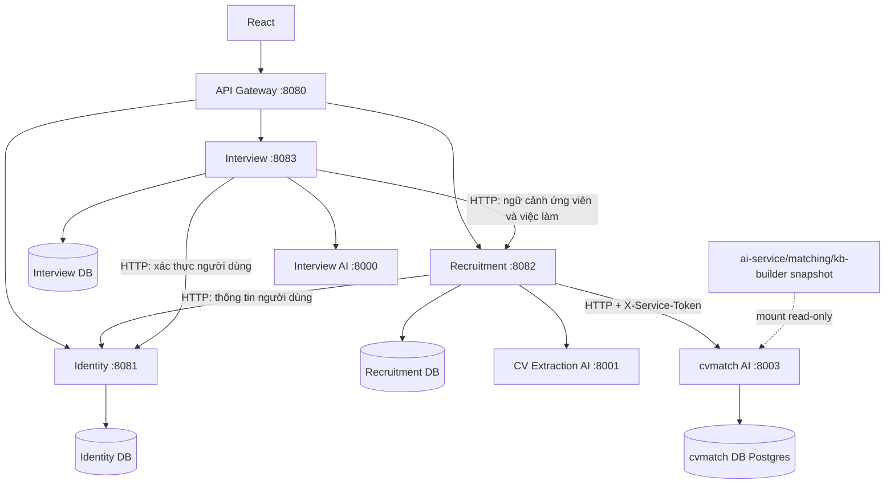

# HireLens backend — Microservices

Backend được tách theo nghiệp vụ thành ba ứng dụng Spring Boot. Mỗi ứng dụng có JAR, cấu hình, database, tài khoản database và Flyway riêng. `common` chỉ là thư viện mã nguồn dùng chung cho xác thực/HTTP/DTO, không có entity, repository hoặc database chung.

| Thành phần | Cổng local | Sở hữu dữ liệu |
|---|---:|---|
| API Gateway (Nginx) | 8080 | Định tuyến, không có database |
| Identity Service | 8081 | Người dùng, đăng nhập, JWT, chọn vai trò |
| Recruitment Service | 8082 | Hồ sơ CV, công ty, tin tuyển dụng, ứng tuyển, kết quả matching |
| Interview Service | 8083 | Câu hỏi, rubric, phiên phỏng vấn, câu trả lời, kết quả chấm |
| CV Extraction AI | 8001 | Qwen3, KB/KG; mã từ `hocnv/DO-06@920d109` |
| cvmatch AI | 8003 | `ai-service/matching/service`: Retrieve + Rerank BERTScore bge-m3 + Explain (profile `match`) |
| cvmatch DB | 5433 | Postgres 16 + pgvector, dữ liệu dẫn xuất của cvmatch (dựng lại được từ Recruitment DB) |
| Interview AI | 8000 | Dịch vụ chấm phỏng vấn hiện có tại `ai-service/interview/service/` |



## Lưu dữ liệu trên ổ DATA

Database, PDF upload và cache Hugging Face của dự án được gắn vào `data/runtime/` trên ổ DATA (biến `STORAGE_ROOT`). File Qwen tiếp tục nằm ở `ai-service/models/cv-extraction/` cũng trên DATA. Các thư mục runtime đã được tạo sẵn và không đưa vào Git.

Để cả image/build cache của Docker và containerd nằm trên DATA, sau khi cài Docker/rsync chạy từ thư mục gốc:

```bash
sudo bash backend/scripts/setup-storage.sh
```

Script tạm dừng Docker/containerd, sao chép dữ liệu hiện có, giữ nguyên cấu hình khác và các bản gốc, rồi đổi vị trí lưu sang `data/docker-engine/` và `data/containerd/`. Không xoá volume hay dữ liệu cũ. Script áp dụng cho Docker Engine rootful dùng systemd, không dành cho Docker Desktop/rootless. Ổ DATA phải được mount trước khi chạy Docker. Nếu đã tạo các volume của stack ở cấu hình cũ, cần chuyển dữ liệu volume có kiểm tra trước khi thay định nghĩa volume; không dùng `down -v` để ép tạo lại.

## Chạy bằng Docker

Từ thư mục gốc dự án, cần Docker Engine và Docker Compose:

```bash
cp .env.microservices.example .env
docker compose up -d --build
```

Lệnh này chạy gateway, ba service Java và ba database mới. API vẫn là `http://localhost:8080/api`; frontend giữ nguyên proxy `/api` tới cổng 8080. MySQL cũ không bị xoá hoặc dùng làm database chung.

Để có AI chấm phỏng vấn:

```bash
docker compose --profile ai up -d --build
```

Để chạy cả hai AI về CV, đặt **đúng** file `model-v4-q4_k_m.gguf` vào `ai-service/models/cv-extraction/`, rồi:

```bash
docker compose --profile ai --profile cv-ai up -d --build
```

File GGUF không có trong Git. Cấu hình tích hợp hiện chọn v4 theo checkpoint mới ở commit 31e8a1d. Cần GGUF v4 đúng phiên bản; các kết quả đánh giá v3/v4 trước đó vẫn là số liệu riêng của từng phiên bản. Bộ cài trích xuất dùng llama.cpp CPU; GPU cần image riêng có CUDA. Matching (`cvmatch-ai`, profile `match`) tải bge-m3 (~2,3 GB) ở lần đầu vào volume `cvmatch_model_cache`.

Có thể dùng AI chạy trên máy khác/Colab bằng cách đặt `CV_EXTRACTION_URL`, `CVMATCH_URL` trong `.env` rồi tạo lại Recruitment Service:

```bash
docker compose up -d --force-recreate recruitment-service
```

Khi AI chưa sẵn sàng, upload/matching trả lỗi rõ ràng; không sinh hồ sơ hoặc điểm mẫu. Các chức năng tài khoản và việc làm vẫn chạy độc lập.

Tài khoản seed: `candidate@hirelens.local`, `recruiter@hirelens.local`, `admin@hirelens.local`; mật khẩu `demo1234`.

## Chạy Java trên máy

Cần JDK 17+ và Maven Wrapper. Khởi động database:

```bash
docker compose up -d identity-db recruitment-db interview-db
cd backend
./mvnw clean package
```

Chạy ở ba terminal riêng:

```bash
java -jar identity-service/target/identity-service-0.0.1-SNAPSHOT.jar
java -jar recruitment-service/target/recruitment-service-0.0.1-SNAPSHOT.jar
java -jar interview-service/target/interview-service-0.0.1-SNAPSHOT.jar
```

Cấu hình mặc định dùng MySQL local cổng 3307, 3308, 3309. Nếu chạy các ứng dụng bằng Java thay vì container, cần cấu hình Nginx tương ứng với địa chỉ host; cấu hình gateway đi kèm dành cho Compose. Có thể kiểm thử trực tiếp từng cổng service.

## API và hai module CV

Đường dẫn frontend không thay đổi:

| Prefix | Gateway chuyển tới |
|---|---|
| `/api/auth/**` | Identity |
| `/api/cvs/**`, `/api/jobs/**`, `/api/applications/**`, `/api/matching/**`, `/api/dashboard/**` | Recruitment |
| `/api/interviews/**` | Interview |

Trong Recruitment có hai module riêng:

- `service/cv/CvExtractionModule`: PDFBox đọc PDF theo bố cục (mã từ DO-06), gọi `/api/v1/extract-cv`, chuyển kết quả thành các trường CV để sửa trên giao diện. Lưu thêm `extracted_profile` để giữ học vấn/kinh nghiệm có cấu trúc.
- `service/cvmatch/*`: đồng bộ CV/JD sang `cvmatch-ai` và gọi matching (mục "Matching CV ↔ JD (cvmatch)").

Matching AI có adapter cho schema Module 1: lấy tên từ `personal_info`, chức danh từ `experience[]`, số năm làm việc từ khoảng thời gian và không đếm trùng các tháng chồng lấn. Không suy đoán bằng cấp chỉ dựa vào tên trường. Sửa tiêu đề kinh nghiệm trên form được ưu tiên; số năm vẫn lấy từ ngày tháng trong bản trích xuất vì form hiện tại không có trường sửa ngày. Xoá hết kinh nghiệm sẽ đưa số năm về 0. Kết quả batch được sắp lại theo điểm matching.

Chưa bổ sung OCR cho PDF scan, chưa thay công thức trọng số của nhánh matching bằng XGBoost, và chưa thay KB của DO-06 bằng phiên bản trong báo cáo Chương 4 riêng.

## Matching CV ↔ JD (cvmatch)

Module `ai-service/matching/service` đã thay hẳn dịch vụ `cv-matching-ai` cũ (đã gỡ; dòng cũ trong `matching_results` giữ
`engine = 'legacy'` và không còn hiện). Kế hoạch và ghi chú bàn giao: `plan/` (I01–I09).

- **Dữ liệu:** Recruitment DB là nguồn sự thật. Sau khi lưu CV (`upload`, `confirm`) hoặc job (`create`, đổi trạng thái),
  `service/cvmatch/CvMatchSync` gửi sang cvmatch **sau commit, chạy nền**: CV = `extracted_profile` của Module 1 + các mục
  đã sửa trên form + email tài khoản; JD = bảng `jobs`/`job_skills`, `jd_id = job-<id>`. Trạng thái ở `match_cv_link`,
  `match_jd_link` (`SYNCED`, `FAILED` → thử lại mỗi phút có backoff, `INVALID` → chờ dữ liệu đổi).
- **Matching:** ứng viên "Phù hợp với tôi" = một lần gọi Luồng D cho mọi job đang mở; recruiter "Ghép hồ sơ" =
  `POST /api/matching/jobs/{id}/refresh` (ứng viên đã nộp đơn; `{"scope":"pool"}` cả kho, chỉ ADMIN); giải thích
  `GET /api/matching/{id}/explanation` (ứng viên không thấy điểm). Kết quả lưu ở `matching_results` với
  `engine = 'cvmatch'`, `direction = jd_to_cv | cv_to_jd`, `band`, `rank_position`, `run_id`.
- **Vận hành:** dựng lại cvmatch DB (lần đầu bật, đổi `CVMATCH_HMAC_KEY`, đổi KB / model, mất volume):

  ```bash
  curl -X POST -H "X-Service-Token: $SERVICE_TOKEN" "http://127.0.0.1:8082/internal/cvmatch/backfill?scope=all"
  ```

  Scheduler sẽ gửi lại toàn bộ (job trước, CV sau). `CVMATCH_SYNC_ENABLED=false` tắt đồng bộ (stack không bật `match`).
- **Đổi KB:** phát hành snapshot ở `ai-service/matching/kb-builder` (`release_check.py`), đặt `CVMATCH_ONTOLOGY_VERSION`, khởi động lại
  `cvmatch-ai` (tự nạp snapshot), rồi backfill như trên.
- **Kiểm tra:** `python3 backend/scripts/smoke-stack.py` (thêm `--cv <pdf>` để chạy cả Qwen; `--no-matching` nếu không bật `match`).
  Hợp đồng API: `ai-service/matching/service/openapi.json`; test hợp đồng với cvmatch thật: đặt `CVMATCH_IT_URL` rồi `./mvnw test`.

## Giao tiếp và xác thực

Mỗi service xác minh chữ ký JWT. Recruitment/Interview lấy trạng thái và vai trò hiện hành từ Identity bằng HTTP; không truy cập database Identity. Tài khoản bị khoá bị từ chối. Các API nội bộ `/internal/**` yêu cầu `X-Service-Token`, và gateway chặn prefix này. Cổng service/database chỉ publish lên loopback để thuận tiện phát triển. Đặt cùng `JWT_SECRET` và `SERVICE_TOKEN` giữa các service; đổi các giá trị mẫu trước khi triển khai bên ngoài.

Identity chỉ lưu tài khoản/vai trò. Recruitment tạo hồ sơ ứng viên/nhà tuyển dụng khi cần, theo thao tác idempotent. Interview lưu ID tham chiếu và bản chụp tiêu đề việc làm, không có JPA join hay khoá ngoại sang database Recruitment. Tạo phiên có application sẽ kiểm tra ứng viên sở hữu application và job tương ứng.

Dashboard gọi Interview qua HTTP để lấy số câu hỏi; nếu service đó lỗi, dashboard báo lỗi upstream thay vì trả số 0 giả.

## Chuyển dữ liệu cũ

`legacy-migrations/` giữ nguyên các migration cũ V1–V6 để tham khảo. **Không chạy baseline mới lên database `recruit_system` cũ.** Các service mặc định dùng database mới.

1. Sao lưu database và `backend/uploads`, dừng ghi dữ liệu ở hệ thống cũ.
2. Khởi động stack mới một lần để Flyway tạo các bảng, sau đó dừng ba service Java để không có ghi đồng thời. Giữ các database đang chạy.
3. Xuất dữ liệu cũ V6 bằng script chỉ đọc (dùng MySQL CLI và file credentials của bạn):

```bash
python3 backend/scripts/export-legacy.py \
  --mysql-command 'mysql --defaults-extra-file=/absolute/path/mysql-client.cnf' \
  --source recruit_system --output backend/legacy-export
```

Nếu MySQL cũ ở volume Docker trước đây, dùng `docker compose --profile legacy up -d mysql` để mở lại, sau đó dùng client tương ứng. Không dùng `docker compose down -v`.

4. Kiểm tra ba file SQL. Chúng **thay toàn bộ dữ liệu ở database đích**, không đổi database nguồn và không copy bảng Flyway. Nhập từng file vào đúng database:

```bash
docker compose exec -T identity-db sh -c 'MYSQL_PWD="$MYSQL_PASSWORD" mysql -uhirelens "$MYSQL_DATABASE"' < backend/legacy-export/identity.sql
docker compose exec -T recruitment-db sh -c 'MYSQL_PWD="$MYSQL_PASSWORD" mysql -uhirelens "$MYSQL_DATABASE"' < backend/legacy-export/recruitment.sql
docker compose exec -T interview-db sh -c 'MYSQL_PWD="$MYSQL_PASSWORD" mysql -uhirelens "$MYSQL_DATABASE"' < backend/legacy-export/interview.sql
```

5. Chép file upload cũ vào volume `recruitment_uploads` nếu cần giữ file PDF; cập nhật đường dẫn lưu cũ nếu bổ sung chức năng tải file. Script giữ các ID và bổ sung `candidate_user_id`/`job_title` cho phiên phỏng vấn từ dữ liệu nguồn. Khởi động lại các service, kiểm tra tài khoản, CV, tin đăng và lịch sử phỏng vấn trước khi dùng hệ thống mới.

CV cũ không có JSON trích xuất vẫn giữ được nội dung form, nhưng cần tải lại để matching có kinh nghiệm/ngày tháng đầy đủ.

## Kiểm tra

```bash
cd backend
./mvnw test
```

```bash
cd ai-service/matching/service
python -m pytest -q        # can Postgres (docker compose up -d trong ai-service/matching/service)
```

Chạy kiểm tra đầu cuối qua gateway sau khi các AI sẵn sàng:

```bash
python3 backend/scripts/smoke-stack.py
```

Để kiểm tra hai mô hình thật, chạy `python3 backend/scripts/smoke-stack.py --cv /absolute/path/CV.pdf`. Script kiểm tra Qwen theo `--model-version` (mặc định v4) và `/health` của cvmatch (`--cvmatch-url`, cảnh báo nếu là FakeEncoder), upload PDF vào tài khoản ứng viên demo (thay CV hiện có), xác nhận hồ sơ, rồi kiểm tra matching: "Phù hợp với tôi" + giải thích ứng viên, nộp đơn, recruiter xếp hạng + giải thích HR. Không truyền `--cv` thì dùng CV đang có của ứng viên demo; `--no-matching` bỏ phần matching. Các endpoint `/health` phản ánh service đang chạy; health của extraction chỉ thành công khi model đã được nạp.

## Module 3 v2

Ngân hàng mới có 30 câu, 90 tiêu chí và 390 đáp án/điểm tổng hợp, được nhập bằng Flyway V4. BERTScore là mặc định cho cả backend và Interview AI; `INTERVIEW_SCORING_MODE=fast` là chế độ lexical thay thế được chọn tường minh, không phải fallback khi model lỗi.

Luồng chấm lưu Precision/Recall/F1, điểm từng tiêu chí, coverage và phiên bản bộ chấm; tự kết thúc phiên khi đủ câu, có API lịch sử và tổng kết. Hướng dẫn đầy đủ ở `docs/Module3_Interview_Flow.md`. Dùng `python3 backend/scripts/smoke-interview.py` để kiểm tra cả chấm điểm và kết quả được lưu sau khi stack sẵn sàng.

## Khắc phục lỗi khởi động thiếu bảng (Spring Boot 4)

`Schema validation: missing table [users]` trên database mới từng xuất hiện vì chỉ có `flyway-core`, thiếu auto-configuration của Spring Boot 4. Cả ba service hiện khai báo `spring-boot-starter-flyway` và `flyway-mysql`. Giữ `ddl-auto=validate`; không chuyển sang `update`, không tạo bảng thủ công và không xoá volume.

Đã sửa thêm đăng ký servlet filter tuỳ chọn: chỉ tạo `hookRegistration` khi có `AuthenticatedRequestHook`, tránh lỗi filter null khi khởi động Identity/Interview.

Build lại ba service Java rồi khởi động để Flyway tạo bảng và seed theo từng database. Log cần có Flyway migrate thành công trước Hibernate. Kiểm tra `http://localhost:8080/health`, đăng nhập và chạy `backend/scripts/smoke-interview.py` trước khi kết luận website đã thông luồng.
