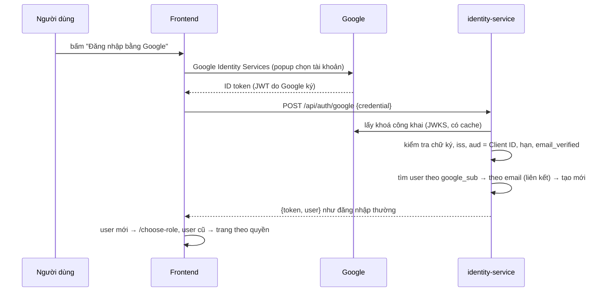

# Đăng nhập bằng Google

Người dùng bấm **"Đăng nhập bằng Google"** ở trang Đăng nhập hoặc Đăng ký. Spec: [`specs/005-google-login/spec.md`](../specs/005-google-login/spec.md).

## 1. Bật tính năng (làm một lần)

1. Vào [Google Cloud Console](https://console.cloud.google.com/) → chọn hoặc tạo project.
2. **APIs & Services → OAuth consent screen**: chọn *External*, điền tên ứng dụng, email hỗ trợ, rồi lưu. Ở chế độ *Testing*, chỉ các email thêm trong mục *Test users* mới đăng nhập được.
3. **APIs & Services → Credentials → Create credentials → OAuth client ID**:
   - Application type: **Web application**
   - **Authorized JavaScript origins**: `http://localhost:5173`, cùng domain thật nếu có deploy
   - Không cần *Authorized redirect URIs*, vì hệ thống không dùng redirect
4. Chép **Client ID** (dạng `xxxx.apps.googleusercontent.com`) vào file `.env` ở gốc repo. Backend và FE dùng cùng một giá trị:
   ```
   GOOGLE_CLIENT_ID=xxxx.apps.googleusercontent.com
   VITE_GOOGLE_CLIENT_ID=xxxx.apps.googleusercontent.com
   ```
   Không cần *Client secret*.
5. Khởi động lại identity-service và Vite (`npm run dev`) để nạp biến mới. Chạy bằng Docker thì dùng `docker compose up -d identity-service`.

Chưa đặt Client ID: nút Google bị ẩn, `POST /api/auth/google` trả 503.

## 2. Luồng hoạt động



Cách ghép tài khoản:

| Trường hợp | Kết quả |
|---|---|
| Đã từng đăng nhập Google (`users.google_sub` khớp) | Đăng nhập vào tài khoản đó |
| Có tài khoản đăng ký bằng mật khẩu cùng email | **Tự liên kết**: lưu `google_sub`, đánh dấu email đã xác thực; đăng nhập bằng mật khẩu vẫn dùng được |
| Chưa có tài khoản | Tạo tài khoản: email đã xác thực, họ tên lấy từ Google, chưa chọn vai trò, mật khẩu ngẫu nhiên (muốn đăng nhập bằng mật khẩu thì dùng "Quên mật khẩu") |
| Tài khoản bị khoá | 403, mã `2005` |
| Token sai, hết hạn, cấp cho ứng dụng khác, email Google chưa xác thực, hoặc email đã liên kết với tài khoản Google khác | 401, mã `2008` |

Sau khi đăng nhập, quyền của người dùng vẫn theo vai trò và ma trận RBAC như mọi tài khoản khác ([RBAC.md](RBAC.md)).

## 3. Code liên quan

| Phần | File |
|---|---|
| Migration (cột `google_sub`) | `identity-service/.../db/migration/V6__google_login.sql` |
| Xác minh ID token | `identity-service/.../service/impl/GoogleTokenVerifierImpl.java` (dùng `spring-security-oauth2-jose`) |
| Ghép / tạo tài khoản | `AuthServiceImpl.googleLogin` |
| Endpoint | `POST /api/auth/google` trong `AuthController` (công khai, khai báo trong `SecurityConfig`) |
| Cấu hình | `app.auth.google-client-id` (`GOOGLE_CLIENT_ID`), `app.auth.google-jwks-uri` |
| Nút Google (FE) | `components/common/GoogleSignInButton.tsx`, `GoogleAuthBlock.tsx`, `utils/google.ts` |

Vite đọc `.env` ở gốc repo (`envDir: ".."` trong `vite.config.ts`). Chỉ biến có tiền tố `VITE_` được đưa ra trình duyệt.

## 4. Kiểm thử

- **Unit:**
  - `GoogleTokenVerifierImplTest` dùng khoá RSA tự tạo, kiểm tra token hợp lệ, sai `aud`, sai `iss`, hết hạn, sai chữ ký, chưa cấu hình.
  - `AuthServiceTest` kiểm tra tạo user mới, liên kết theo email, tài khoản đã liên kết, tài khoản bị khoá, email chưa xác thực, email đã liên kết Google khác.
- **Thủ công:** đặt Client ID như mục 1, mở `http://localhost:5173/login`, bấm nút Google. Ở chế độ *Testing*, email đăng nhập phải nằm trong *Test users*.

## 5. Lỗi thường gặp

| Hiện tượng | Cách xử lý |
|---|---|
| Không thấy nút Google | Thiếu `VITE_GOOGLE_CLIENT_ID`, hoặc chưa chạy lại `npm run dev` sau khi sửa `.env` |
| Popup Google báo `origin_mismatch` / "not allowed" | Thêm đúng origin (vd `http://localhost:5173`) vào *Authorized JavaScript origins*, chờ vài phút |
| Popup báo ứng dụng chưa được xác minh / chặn email | OAuth consent screen đang *Testing*: thêm email vào *Test users* |
| API trả 503 "chưa được cấu hình" | identity-service chưa có `GOOGLE_CLIENT_ID`; đặt trong `.env` rồi khởi động lại |
| API trả 401 mã 2008 với token thật | `GOOGLE_CLIENT_ID` (backend) khác `VITE_GOOGLE_CLIENT_ID` (FE), hoặc identity-service không ra Internet được để lấy JWKS của Google |
