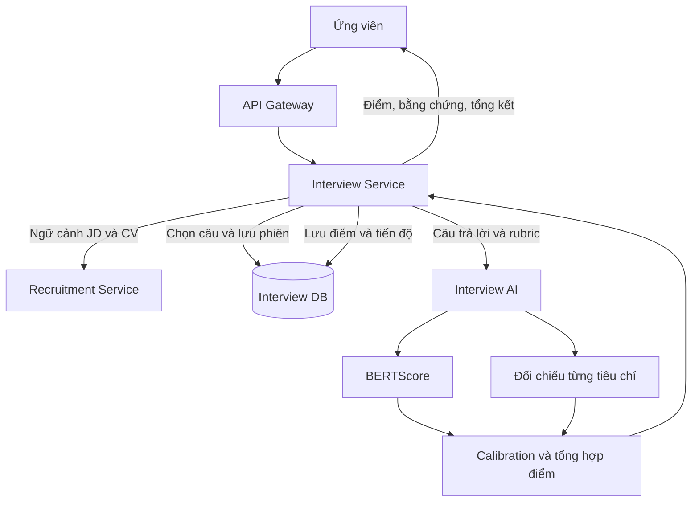

# Module 3 — Luyện phỏng vấn và chấm điểm, phiên bản v2

## Trạng thái

Đã triển khai ngân hàng câu hỏi, chọn câu theo ngữ cảnh, chấm BERTScore/fast, lưu bằng chứng chấm, hoàn thành phiên, xem lịch sử và tổng kết. Build Java và frontend đã qua. Calibration `fast` đã chạy trên dữ liệu tổng hợp. Test tự động semantic tại môi trường sửa code giả lập ranh giới model. Log và response do người dùng chạy trên máy đã xác nhận tải BERTScore, huấn luyện calibration semantic và chấm trực tiếp thành công. Chưa xác nhận toàn bộ website E2E; lỗi Identity thiếu bảng do Flyway auto-configuration đã được sửa trong code, cần rebuild để kiểm tra. Không có số liệu chất lượng trên đáp án do chuyên gia chấm.

## Dữ liệu mới

| Thành phần | Nội dung |
|---|---|
| Câu hỏi | 30 câu, 10 chủ đề, mỗi chủ đề có Intern/Junior/Middle |
| Chủ đề | Java, Spring Boot, SQL, REST API, Python, React, Docker, Git, Security, Machine Learning |
| Dạng | Kiến thức, áp dụng, tình huống |
| Rubric | 3 tiêu chí/câu, tổng 90; trọng số 0,40 / 0,35 / 0,25 |
| Nội dung tiêu chí | Ý đúng, cách diễn đạt tương đương, từ khóa gợi ý, ngộ nhận sai cần phát hiện |
| Đáp án tổng hợp | 390 mẫu: đầy đủ, từng tập con ý đúng, paraphrase, sai, chưa biết, lạc đề, nhồi từ khóa, đúng/sai trộn |
| Nhãn | `target_score`, `label_source=synthetic_rubric`; không phải điểm người chấm |
| Provenance | `review_status=needs_expert_review`, `source=synthetic-ai-v2` |

Nguồn tạo có thể chạy lại: `ai-service/interview/service/scripts/build_interview_bank.py`. Đầu ra:

- `ai-service/interview/service/data/interview_bank_v2.json`: bản chuẩn cho câu hỏi/rubric.
- `ai-service/interview/service/data/interview_answers_v2.csv`: ví dụ và điểm mục tiêu.
- `ai-service/interview/service/data/interview_bank_v2_seed.sql`: seed bổ sung, dùng khi chuyển dữ liệu cũ.
- `backend/interview-service/src/main/resources/db/migration/V4__interview_bank_and_assessment.sql`: schema và seed Flyway.

Không thay thế các file dữ liệu cũ, không xóa câu hỏi hoặc lịch sử cũ. Sau khi migration V4 đã được áp dụng, việc thay nội dung ngân hàng phải dùng migration mới; không sửa checksum V4 trên database đã chạy.

## Chọn câu hỏi

Frontend chỉ tạo phiên khi bấm **Bắt đầu**, không tạo tự động khi mở trang. Mặc định 6 câu; API cho phép 1–12 câu.

Interview gọi Recruitment để lấy ID ứng viên, ID/tiêu đề việc làm, kỹ năng bắt buộc của JD, kỹ năng CV, cấp độ và chủ sở hữu tin. Không đọc trực tiếp database Recruitment.

Cấp độ suy từ chức danh JD: Intern/Fresher → Intern; Middle/Senior/Lead → Middle; trường hợp còn lại → Junior. Đây là quy tắc ban đầu; ngân hàng hiện chưa có bộ Senior riêng. Nếu không chọn JD, dùng kỹ năng CV và cấp mặc định Junior.

Bộ chọn ưu tiên:

1. Kỹ năng bắt buộc của JD, sau đó kỹ năng ứng viên.
2. Cấp độ gần mục tiêu; không cao hơn mục tiêu quá một bậc.
3. Giảm ưu tiên câu đã xuất hiện trong 36 lượt câu gần đây.
4. Cố gắng đa dạng chủ đề/dạng câu, tối đa 2 câu/chủ đề ở lượt chọn đầu.
5. Bổ sung câu nền tảng/general hoặc nới đa dạng nếu pool nhỏ; không lặp ID trong phiên.

Đây là ranking tất định, không phải LLM sinh câu theo thời gian thực. Chưa tạo câu hỏi riêng từ mô tả dự án cá nhân. API chỉ định ID thủ công sẽ kiểm tra tồn tại, active, không trùng và tối đa 12 câu.

## Luồng toàn hệ thống



### Tạo phiên

`POST /api/interviews/sessions` nhận `jobId`, `applicationId`, `questionCount` hoặc `questionIds` tùy chọn. Backend xác thực ứng viên; nếu có application thì Recruitment kiểm tra ownership và job tương ứng. Sau khi chọn câu, lưu thứ tự và điểm tối đa ở `interview_session_questions`.

### Gửi câu trả lời

`POST /api/interviews/sessions/{id}/responses` nhận `questionId`, `answerText` (tối đa 4.000 ký tự).

Backend kiểm tra chủ phiên, câu thuộc phiên, phiên chưa kết thúc. Khóa hàng phiên trong transaction để tránh cập nhật tiến độ đồng thời; gọi AI với đáp án/rubric từ database, không nhận rubric do ứng viên tự gửi. Nếu AI lỗi, transaction không ghi nhận điểm thành công giả.

### Chấm điểm

Mặc định `bertscore`:

1. BERTScore tính Precision/Recall/F1 giữa đáp án và reference đầy đủ.
2. BERTScore đối chiếu các mệnh đề với các cách diễn đạt đúng và ngộ nhận sai của từng tiêu chí.
3. Phát hiện ngộ nhận đã khai báo bằng đối chiếu cụm từ; semantic chỉ bổ trợ. Nhồi toàn từ khóa không được tính đủ ý.
4. Một ý trùng đầy đủ cách diễn đạt tham khảo được ghi nhận; ngược lại đối chiếu ngưỡng semantic và bằng chứng lexical. Mỗi tiêu chí được mức 1 (đủ), 0,5 (cần làm rõ) hoặc 0 (thiếu/mâu thuẫn). Ngưỡng semantic mặc định 0,85; vùng partial từ 0,80, có thể cấu hình bằng `HIRELENS_CRITERION_THRESHOLD`. Đây là heuristic, chưa được hiệu chỉnh trên nhãn chuyên gia.
5. Ridge sử dụng P/R/F1 toàn câu, coverage lexical và đặc trưng độ dài. Công thức tổng hợp:

   `điểm = min(0,5 × điểm_Ridge + 0,5 × điểm_rubric, điểm_rubric + 2)`

   Trong đó `điểm_rubric = 10 × tổng(trọng số × mức đạt)`. Ridge được chặn 0–10; trường hợp chỉ nhồi từ khóa bị giới hạn tối đa 1 điểm.
6. Trả nhận xét theo quy tắc và bằng chứng theo tiêu chí. Không gọi ChatGPT để viết nhận xét.

Chế độ `fast` dùng overlap từ vựng thay BERTScore và được ghi đúng tên chế độ; các trường BERTScore để null. BERTScore lỗi sẽ báo lỗi, không âm thầm chuyển sang fast.

BERTScorer được cache một lần trong mỗi tiến trình và tuần tự hóa truy cập. Mặc định CPU 2 thread, batch 4, một worker API. Cache model và calibration ở ổ DATA. Ngưỡng không phải xác suất đúng kiến thức; hệ thống không tự xác minh mọi phát biểu hoặc mọi cách diễn đạt phủ định.

### Calibration

`src.bootstrap` kiểm tra checksum dữ liệu và cấu hình. Khi chưa có artifact phù hợp, nó tải model rồi chạy `src.train_calibration`; những lần sau dùng lại artifact cache. Huấn luyện Ridge theo từng mode riêng. Chia train/test theo **question_id**, không tách các biến thể cùng câu sang hai tập. Lưu danh sách ID của hai tập, provenance và checksum trong calibration.

Chỉ số trên bộ test này là mức khớp với **nhãn tổng hợp theo rubric**, không phải bằng chứng tương đương người chấm. BERT không được fine-tune trong quy trình này; chỉ Ridge được huấn luyện trên feature BERTScore.

### Lưu và hoàn thành

`evaluation_results` giữ điểm tổng, coverage, Precision/Recall/F1 thật, chi tiết tiêu chí, mode và phiên bản bộ chấm. Không dùng điểm similarity để gán một trường “độ đúng chuyên môn”.

Phiên chuyển `CREATED → IN_PROGRESS → COMPLETED` khi tất cả câu đã có kết quả. `currentIndex` là câu chưa chấm đầu tiên. Phiên hoàn thành không được sửa đáp án bằng API submit; có thể mở lại xem hoặc tạo phiên mới.

- `GET /api/interviews/sessions/mine`: lịch sử của ứng viên.
- `GET /api/interviews/sessions/{id}`: câu hỏi và tiến độ.
- `GET /api/interviews/sessions/{id}/summary`: số câu đã chấm, điểm trung bình và các đánh giá được lưu.

Ứng viên chỉ đọc phiên của mình. Recruiter chỉ đọc phiên gắn với tin của mình; admin được đọc. Chỉ ứng viên được gửi câu trả lời. Đáp án mẫu không được trả trong danh sách câu hỏi trước khi làm bài.

## Chạy

Tại thư mục gốc, tạo thư mục cache nếu là checkout mới:

```bash
mkdir -p data/runtime/{mysql/identity,mysql/recruitment,mysql/interview,huggingface,uploads,interview-huggingface,interview-output}
```

`.env` chọn `INTERVIEW_SCORING_MODE=bertscore` (mặc định). Build tuần tự và khởi động stack:

```bash
sudo docker compose --parallel 1 --profile ai --profile cv-ai build
sudo docker compose --profile ai --profile cv-ai up -d --no-build
sudo docker compose logs -f interview-service interview-ai
```

Lần đầu Interview AI tải `bert-base-multilingual-cased` và tính feature cho 390 mẫu. Bước này có thể mất nhiều thời gian trên CPU. Chưa hoàn tất thì chưa coi service sẵn sàng. Docker giới hạn Interview AI ở 2 CPU, 4 GB RAM; cache ở DATA. Không huấn luyện lại mỗi lần start nếu checksum không đổi. Không chạy `down -v`.

Kiểm tra:

```bash
curl -f http://localhost:8000/health
python3 backend/scripts/smoke-interview.py --mode bertscore
```

Health cần `default_mode=bertscore`, `calibration_loaded.bertscore=true`, `model_loaded=true`. Script tạo một phiên mới bằng tài khoản demo, trả lời ba câu bằng đáp án tổng hợp, kiểm tra metric thật trong response, rồi kiểm tra phiên hoàn tất và kết quả được lưu. Đây là kiểm tra thông luồng, không đo chất lượng trên người thật.

Frontend:

```bash
cd frontend
npm run dev
```

Vào trang luyện phỏng vấn, bấm bắt đầu, trả lời từng câu, xem điểm/tiêu chí và tổng kết. Các phiên gần đây có nút mở lại để tiếp tục hoặc xem kết quả.

Chạy AI local, cần Python có PyTorch và thư viện BERTScore:

```bash
cd ai-service/interview/service
pip install torch --index-url https://download.pytorch.org/whl/cpu
pip install -r requirements-interview.txt
HIRELENS_MODE=bertscore python -m src.bootstrap
```

Test offline không nạp neural model:

```bash
cd ai-service/interview/service
.venv/bin/python -m unittest discover -s tests -p test_module3.py
```

## Hạn chế cần tiếp tục đánh giá

- Ngân hàng và nhãn do AI tổng hợp cần chuyên gia rà soát; chưa dùng làm quyết định tuyển dụng tự động.
- BERTScore đo tương đồng token theo ngữ cảnh, có thể nhầm câu sai/phủ định; các guard chỉ bao phủ ngộ nhận đã khai báo.
- Bộ mới có 10 chủ đề và tối đa cấp Middle; không phủ hết JD thực tế.
- Chấm semantic trực tiếp đã được người dùng chạy thành công; bản sửa evidence-v3 và website E2E vẫn cần kiểm tra trên các container mới. Cần chạy smoke-interview và đối chiếu với nhãn người chấm trước khi báo cáo chất lượng.

## Tài liệu thư viện

- BERTScore chính thức: https://github.com/Tiiiger/bert_score
- BERTScorer và cơ chế cache: https://github.com/Tiiiger/bert_score/blob/master/bert_score/scorer.py

## Bản sửa evidence-v3 từ kết quả chấm thực tế

Một đáp án nêu đủ Spring Framework, tự động cấu hình và server nhúng từng bị trả coverage 0,45 do so cả câu chứa ba ý với từng reference và đếm các hint đồng nghĩa như yêu cầu độc lập. Đã tách mệnh đề theo dấu phẩy/liên từ (giữ dấu phẩy trong lời gọi hàm), xét hint như phương án diễn đạt, yêu cầu mệnh đề khẳng định và chặn phủ định cục bộ.

Không hạ ngưỡng semantic toàn cục. Khi có mệnh đề khẳng định gắn với label/hint, semantic F1 từ 0,70 có thể bổ trợ ghi nhận đủ ý; trường hợp chỉ có từ khóa, phủ định hoặc similarity thấp không được nâng tự động. Đây vẫn là heuristic cần kiểm chứng bằng nhiều ví dụ thật.

`model_version` thêm `+evidence-v3`. Debug `coverage_score` khớp coverage cuối; `keyword_coverage_score` là feature lexical riêng dùng cho Ridge. Bản sửa không đổi feature hoặc dữ liệu Ridge nên calibration cache không cần được huấn luyện lại. Test hồi quy phát lại các F1 quan sát 0,8156 / 0,7504 / 0,871, không giả tăng các điểm model này.
