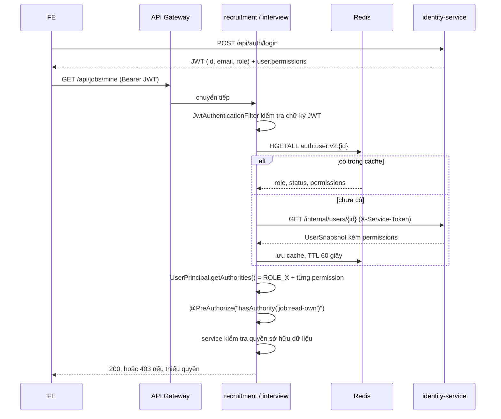

# Phân quyền RBAC: hướng dẫn cho dev

Hệ thống phân quyền theo **RBAC0 dựa trên permission**: mỗi API yêu cầu một *quyền* (permission), mỗi *vai trò* (role) có một tập quyền, mỗi người dùng có đúng một vai trò. Ma trận Role → Permission lưu trong database của identity-service và admin sửa được trên giao diện.

Thiết kế chi tiết và lý do: [`specs/004-rbac/spec.md`](../specs/004-rbac/spec.md), [`specs/004-rbac/plan.md`](../specs/004-rbac/plan.md).

## Quy tắc ngắn gọn

1. **Kiểm tra quyền bằng permission, không bằng role.** Dùng `@PreAuthorize("hasAuthority('job:create')")`, không viết `if (role == ADMIN)` và không gọi `SecurityUtils.requireRole(...)` (đã đánh dấu `@Deprecated`).
2. **Backend là nơi chặn thật.** Ẩn nút hay chặn route ở FE chỉ để giao diện gọn hơn.
3. **Quyền sở hữu dữ liệu vẫn kiểm tra trong service.** Có `job:update` chỉ có nghĩa là được sửa tin, còn "tin này có phải của bạn không" thì service tự kiểm tra.
4. **Thêm quyền mới bằng migration Flyway của identity**, không sửa trực tiếp trong database.

## 1. Mô hình dữ liệu (DB `hirelens_identity`)

| Bảng | Nội dung |
|---|---|
| `roles` | `CANDIDATE`, `RECRUITER`, `ADMIN` |
| `permissions` | `code` dạng `resource:action` (vd `job:create`), `resource`, `description` |
| `role_permissions` | Ma trận: role nào có permission nào |
| `users.role` | Vai trò của người dùng (khoá ngoại tới `roles.code`). Mỗi user một role |

Migration tạo bảng và dữ liệu ban đầu: [`V5__rbac.sql`](../backend/identity-service/src/main/resources/db/migration/V5__rbac.sql).

Đặt tên permission:
- `resource:action`, viết thường, nối bằng `-`: `application:read-received`.
- Hậu tố `-own`: chỉ dữ liệu của chính mình (`cv:manage-own`).
- Hậu tố `-all`: dữ liệu của mọi người (`matching:read-all`), thường dành cho ADMIN.

## 2. Luồng một request



Lưu ý:
- **JWT không chứa permission.** Quyền đọc lại ở mỗi request (qua cache), nên admin sửa ma trận là có hiệu lực ngay, không cần đăng nhập lại.
- **identity-service** tự đọc quyền từ database qua `RbacService.permissionsOf(role)`, có cache trong bộ nhớ.
- Thiếu quyền thì Spring ném `AccessDeniedException`, và `GlobalExceptionHandler` trả **403**. Không có hoặc sai token thì nhận **401**.

## 3. Ma trận hiện tại

| Permission | Dùng cho | CANDIDATE | RECRUITER | ADMIN |
|---|---|:-:|:-:|:-:|
| `cv:manage-own` | GET/POST/PUT `/api/cvs` | ✓ | | |
| `application:apply` | POST `/api/applications/jobs/{id}` | ✓ | | |
| `application:read-own` | GET `/api/applications/mine` | ✓ | | |
| `matching:read-own` | `/api/matching/mine`, giải thích kết quả của mình | ✓ | | |
| `interview:practice` | tạo / làm / xem phiên phỏng vấn của mình | ✓ | | |
| `job:create` | POST `/api/jobs` | | ✓ | |
| `job:update` | PATCH `/api/jobs/{id}/status` (tin của mình) | | ✓ | |
| `job:read-own` | GET `/api/jobs/mine` | | ✓ | |
| `application:read-received` | GET `/api/applications/recruiter` | | ✓ | |
| `matching:run` | xếp hạng ứng viên cho tin của mình | | ✓ | |
| `interview:read-result` | xem phiên của ứng viên vào tin của mình | | ✓ | |
| `dashboard:recruiter` | GET `/api/dashboard/recruiter` | | ✓ | ✓ |
| `question:read` | GET `/api/interviews/questions` | | ✓ | ✓ |
| `matching:read-all` | xem matching của mọi tin | | | ✓ |
| `matching:run-pool` | xếp hạng toàn bộ kho CV (`scope=pool`) | | | ✓ |
| `interview:read-all` | xem mọi phiên phỏng vấn | | | ✓ |
| `user:read` | GET `/api/admin/users` | | | ✓ |
| `user:lock` | khoá / mở khoá tài khoản | | | ✓ |
| `role:manage` | xem và sửa ma trận (`/api/admin/roles`) | | | ✓ |
| `cv-template:manage` | quản lý mẫu CV hệ thống (`/api/admin/cv-templates`) | | | ✓ |

Đây là ma trận lúc khởi tạo; ma trận đang dùng thật xem ở trang **Quản trị → Phân quyền** (`/admin/roles`).

**API không cần permission:**
- Công khai: `/api/auth/login`, `register`, `verify-email`, `forgot-password`, `reset-password`; GET `/api/jobs`, GET `/api/jobs/{id}`; `/health`.
- Chỉ cần đăng nhập: GET `/api/auth/me`, POST `/api/auth/role`.
- `/internal/**` dùng `X-Service-Token` và bị gateway chặn từ bên ngoài.

## 4. Backend: các việc thường gặp

### Thêm endpoint dùng quyền có sẵn

Đặt annotation trên method của controller:

```java
@GetMapping("/mine")
@PreAuthorize("hasAuthority('job:read-own')")
public List<JobDtos.JobResponse> myJobs() { ... }
```

Endpoint dùng chung cho nhiều loại người dùng thì dùng `hasAnyAuthority`:

```java
@GetMapping("/{matchId}/explanation")
@PreAuthorize("hasAnyAuthority('matching:read-own', 'matching:run', 'matching:read-all')")
```

Không dùng `hasRole('ADMIN')`; quyền phải là permission để admin còn chỉnh được trên giao diện.

### Thêm permission mới

1. Tạo migration mới trong identity, ví dụ `V6__perm_company.sql`:
   ```sql
   INSERT INTO permissions (code, resource, description) VALUES
   ('company:approve', 'company', 'Duyệt / từ chối công ty');
   INSERT INTO role_permissions (role_code, permission_code) VALUES ('ADMIN', 'company:approve');
   ```
2. Gắn `@PreAuthorize("hasAuthority('company:approve')")` lên endpoint.
3. FE: thêm `perm` cho route hoặc mục menu, bọc nút bằng `<Can>` (xem mục 5).
4. Cập nhật bảng ở mục 3 của tài liệu này.

Không sửa `V5__rbac.sql`; Flyway sẽ báo lỗi checksum trên các database đã chạy migration đó.

### Kiểm tra quyền trong service

Chỉ dùng khi logic **rẽ nhánh theo quyền**, còn chặn cả endpoint thì đã có `@PreAuthorize`:

```java
// ADMIN có matching:read-all được xem mọi tin, còn lại chỉ tin của mình
if (!SecurityUtils.hasPermission("matching:read-all")
        && !job.getCreatedById().equals(SecurityUtils.currentUser().getId())) {
    throw new ApiException(HttpStatus.FORBIDDEN, "Not your job");
}
```

So sánh role vẫn được phép khi chỉ để **chọn luồng xử lý**, không để cấp quyền. Ví dụ `explanation()` chạy luồng ứng viên hoặc luồng recruiter tuỳ `principal.getRole()`.

### Các file chính

| Vai trò | File |
|---|---|
| Đọc / sửa ma trận | `identity-service/.../service/impl/RbacServiceImpl.java` |
| API quản trị ma trận | `identity-service/.../controller/AdminRoleController.java` |
| Gắn permission vào user | `CustomUserDetailsService` (identity), `InternalUserController` (`/internal/users`) |
| Principal và authorities | `common/.../security/UserPrincipal.java` |
| Cache quyền dùng chung | `common/.../security/UserSnapshotCache.java` (key `auth:user:v2:{id}`) |
| Nạp principal ở service khác | `common/.../security/RemotePrincipalLookup.java` |

## 5. Frontend

`/api/auth/me` và phản hồi đăng nhập có `user.permissions`.

| Nhu cầu | Cách dùng |
|---|---|
| Kiểm tra trong code | `const { can } = useAuth(); if (can("job:create")) …` |
| Ẩn / hiện phần giao diện | `<Can perm="job:create"><Button>…</Button></Can>` |
| Chặn route | `<RequireAuth perm="user:read">…</RequireAuth>` trong `App.tsx` |
| Mục menu bên trái | thêm `perm` cho mục trong `ENTRIES` ở `RecruiterLayout.tsx`; mục thiếu quyền tự ẩn |
| Trang đầu sau đăng nhập | `utils/account.ts` chọn theo quyền |

`perm` nhận một chuỗi, hoặc một mảng (có một trong số đó là đủ): `perm={["matching:run", "matching:read-all"]}`.

Trang quản trị:
- `/admin/users` cần `user:read`; nút khoá / mở khoá cần `user:lock`.
- `/admin/roles` cần `role:manage`; ô `role:manage` của ADMIN bị khoá, không bỏ chọn được.

## 6. Cache và thời điểm có hiệu lực

| Thay đổi | Hiệu lực |
|---|---|
| Admin sửa ma trận qua API / trang Phân quyền | Ngay ở request kế tiếp. identity xoá cache trong bộ nhớ và mọi key `auth:user:v2:*` |
| Admin khoá tài khoản | Ngay, vì key cache của user đó bị xoá |
| Sửa thẳng bảng `role_permissions` trong DB | **Không tự cập nhật.** Phải khởi động lại identity-service và chờ tối đa 60 giây cho cache Redis hết hạn. Nên dùng API |

Khi thay đổi cấu trúc dữ liệu lưu trong cache, đổi luôn tiền tố key (hiện là `v2`) để các entry cũ bị bỏ qua sau khi deploy.

## 7. Kiểm thử

- **Unit:**
  - `PermissionAuthoritiesTest` (common): authorities gồm `ROLE_X` và từng permission.
  - `RbacServiceImplTest` (identity): cache ma trận, chặn gỡ `role:manage` của ADMIN, từ chối permission không tồn tại.
  - `AdminControllersSecurityTest` (identity): mẫu kiểm tra `@PreAuthorize` trên controller bằng context Spring nhỏ có `@EnableMethodSecurity`. Endpoint mới quan trọng nên có test theo mẫu này.
- **Thử nhanh bằng curl** qua gateway, dùng tài khoản seed (mật khẩu `demo1234`): `candidate@`, `recruiter@`, `admin@hirelens.local`.
  ```bash
  T=$(curl -s localhost:8080/api/auth/login -H 'content-type: application/json' \
      -d '{"email":"recruiter@hirelens.local","password":"demo1234"}' | jq -r .token)
  curl -s -o /dev/null -w '%{http_code}\n' localhost:8080/api/cvs -H "Authorization: Bearer $T"   # 403
  curl -s localhost:8080/api/auth/me -H "Authorization: Bearer $T" | jq .permissions
  ```

## 8. Lỗi thường gặp

| Hiện tượng | Nguyên nhân thường gặp |
|---|---|
| Endpoint mới trả 403 với mọi user | Quên `INSERT INTO role_permissions` cho permission mới, hoặc gõ sai mã permission trong `@PreAuthorize` |
| Endpoint mới ai đăng nhập cũng gọi được | Quên `@PreAuthorize` |
| Trả 500 thay vì 403 | Ném exception khác trong service; thiếu quyền thì để `@PreAuthorize` xử lý, hoặc ném `ApiException(HttpStatus.FORBIDDEN, …)` |
| Sửa ma trận xong FE vẫn hiện nút cũ | FE lấy permission từ `/me` lúc tải trang; tải lại trang. Backend thì đã chặn ngay |
| Đã thêm quyền trong DB nhưng vẫn 403 | Sửa DB trực tiếp: khởi động lại identity-service (xem mục 6) |

## 9. Chưa có (làm ở các đợt sau)

- Vai trò trong công ty (OWNER / MANAGER / RECRUITER / VIEWER). Đây là quyền theo phạm vi từng công ty, sẽ làm cùng nhóm task RC-07…10.
- Một user nhiều role (bảng `user_roles`): hiện chưa cần.
- Trang tổng hợp dữ liệu toàn hệ thống cho ADMIN (mọi tin, mọi đơn): task JB-10, DB-02.
