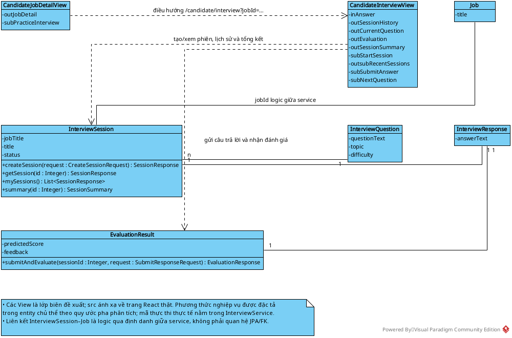

# Biểu đồ lớp pha phân tích M4: Ôn tập và chấm phỏng vấn

**Bước 1.** Từ kịch bản M4, xác định hai giao diện chính: chi tiết tin tuyển dụng và luyện phỏng vấn. Đề xuất lớp biên `CandidateJobDetailView` tương ứng trang `CandidateJobDetailPage.tsx` và `CandidateInterviewView` tương ứng trang `CandidateInterviewPage.tsx`. Thuộc tính `in/out/sub/outsub` được suy ra từ nội dung và thao tác trang thật.

**Bước 2.** Các xử lý trên giao diện gọi những thao tác nghiệp vụ sau. Theo quy ước pha phân tích, thao tác đặt trên lớp thực thể chủ thể; lớp biên chỉ có thuộc tính. Trong mã nguồn, phần thực thi hiện nằm ở `InterviewService` và các API được gọi từ trang.

1. `openSession(id)`  
   Input: `id` phiên  
   Output: dữ liệu phiên và tổng kết phiên; cập nhật lịch sử hiển thị  
   Lớp chủ thể: `InterviewSession`

2. `createSession(request)`  
   Input: `jobId`, `questionCount=6`  
   Output: phiên mới cùng danh sách câu hỏi được chọn  
   Lớp chủ thể: `InterviewSession`

3. `submitAndEvaluate(sessionId, request)`  
   Input: mã phiên, mã câu hỏi, nội dung câu trả lời  
   Output: kết quả đánh giá; dữ liệu phiên/tổng kết được tải lại  
   Lớp chủ thể: `EvaluationResult`

4. `next()`  
   Input: phiên hiện tại và kết quả đánh giá hiện tại  
   Output: chuyển giao diện sang câu tiếp theo, xóa dữ liệu câu trả lời/đánh giá đang hiển thị  
   Lớp chủ thể: `InterviewSession`

**Bước 3.** Giữ các lớp thực thể liên quan đến luồng M4 từ biểu đồ TT: `Job`, `InterviewSession`, `InterviewQuestion`, `InterviewResponse` và `EvaluationResult`, cùng những quan hệ có liên quan. `InterviewSession` điều hướng đến câu hỏi, câu trả lời và kết quả đánh giá theo các lớp trung gian dữ liệu trong TT; liên kết với `Job` là logic qua `jobId` giữa hai service.

**Bước 4.** Nối `CandidateJobDetailView` với `CandidateInterviewView` theo đường điều hướng thật tới `/candidate/interview?jobId=…`. Nối `CandidateInterviewView` tới các thực thể được dùng trong các thao tác mở/tạo phiên và gửi câu trả lời.

Ta được biểu đồ lớp pha phân tích chức năng Ôn tập và chấm phỏng vấn:

## Ghi chú

- Tên lớp biên là tên đề xuất theo mẫu; mỗi lớp có `src` tới trang React thật.
- Chữ ký xử lý nghiệp vụ lấy từ các hàm tương ứng trong `InterviewService`; trong biểu đồ phân tích, thao tác được gắn vào lớp thực thể chủ thể theo quy ước.
- Thứ tự câu hỏi và nội dung đánh giá phụ thuộc dữ liệu/ngữ cảnh thực tế, không giả định kết quả cố định.
