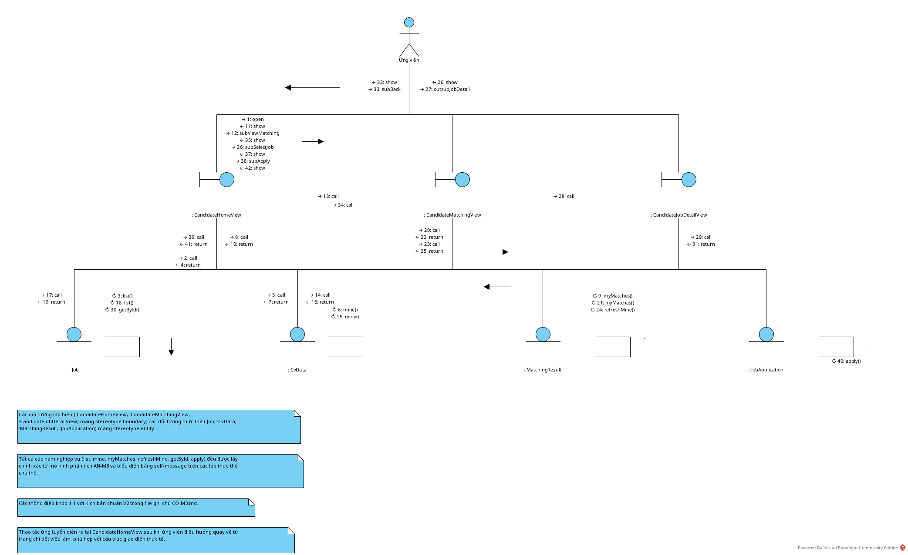

# Biểu đồ giao tiếp pha phân tích M3: Đối sánh CV với việc làm, xem chi tiết việc, ứng tuyển

**Bước 1.** Từ kịch bản chuẩn KB-M3 và mô hình phân tích AN-M3, xác định tác nhân là Ứng viên (`Candidate`) cùng ba lớp biên:
- `CandidateHomeView`: Trang chủ việc làm ứng viên (`CandidateHomePage.tsx:36`).
- `CandidateMatchingView`: Trang việc làm phù hợp CV (`CandidateMatchingPage.tsx:21`).
- `CandidateJobDetailView`: Trang chi tiết việc làm (`CandidateJobDetailPage.tsx:44`).

Các lớp thực thể tham gia luồng chính được giữ đúng theo AN-M3 gồm:
- `Job`: lớp thực thể tin tuyển dụng (`Job.java:18`).
- `CvData`: lớp thực thể dữ liệu hồ sơ CV (`CvData.java:13`).
- `MatchingResult`: lớp thực thể kết quả đối sánh (`MatchingResult.java:19`).
- `JobApplication`: lớp thực thể đơn ứng tuyển (`JobApplication.java:17`).

**Bước 2.** Diễn giải luồng chính thành Kịch bản chuẩn V2 dưới đây. Các bước được đánh số liên tục từ 1 đến 42; các thông điệp trên biểu đồ khớp 1-1 với từng bước của kịch bản. Tên hàm nghiệp vụ chỉ sử dụng các hàm đã được phân công trong AN-M3 (`list()`, `mine()`, `myMatches()`, `refreshMine()`, `getById()`, `apply()`).

## Kịch bản chuẩn V2

1. Ứng viên click chọn truy cập CandidateHomeView.
2. Lớp CandidateHomeView gọi lớp Job để xử lý.
3. Lớp Job thực hiện hàm list().
4. Lớp Job trả kết quả cho lớp CandidateHomeView.
5. Lớp CandidateHomeView gọi lớp CvData để xử lý.
6. Lớp CvData thực hiện hàm mine().
7. Lớp CvData trả kết quả cho lớp CandidateHomeView.
8. Lớp CandidateHomeView gọi lớp MatchingResult để xử lý.
9. Lớp MatchingResult thực hiện hàm myMatches().
10. Lớp MatchingResult trả kết quả cho lớp CandidateHomeView.
11. Lớp CandidateHomeView hiển thị cho Ứng viên.
12. Ứng viên click chọn subViewMatching.
13. Lớp CandidateHomeView gọi lớp CandidateMatchingView để xử lý.
14. Lớp CandidateMatchingView gọi lớp CvData để xử lý.
15. Lớp CvData thực hiện hàm mine().
16. Lớp CvData trả kết quả cho lớp CandidateMatchingView.
17. Lớp CandidateMatchingView gọi lớp Job để xử lý.
18. Lớp Job thực hiện hàm list().
19. Lớp Job trả kết quả cho lớp CandidateMatchingView.
20. Lớp CandidateMatchingView gọi lớp MatchingResult để xử lý.
21. Lớp MatchingResult thực hiện hàm myMatches().
22. Lớp MatchingResult trả kết quả cho lớp CandidateMatchingView.
23. Lớp CandidateMatchingView gọi lớp MatchingResult để xử lý.
24. Lớp MatchingResult thực hiện hàm refreshMine().
25. Lớp MatchingResult trả kết quả cho lớp CandidateMatchingView.
26. Lớp CandidateMatchingView hiển thị cho Ứng viên.
27. Ứng viên click chọn outsubJobDetail.
28. Lớp CandidateMatchingView gọi lớp CandidateJobDetailView để xử lý.
29. Lớp CandidateJobDetailView gọi lớp Job để xử lý.
30. Lớp Job thực hiện hàm getById().
31. Lớp Job trả kết quả cho lớp CandidateJobDetailView.
32. Lớp CandidateJobDetailView hiển thị cho Ứng viên.
33. Ứng viên click chọn subBack.
34. Lớp CandidateJobDetailView gọi lớp CandidateHomeView để xử lý.
35. Lớp CandidateHomeView hiển thị cho Ứng viên.
36. Ứng viên click chọn subSelectJob.
37. Lớp CandidateHomeView hiển thị cho Ứng viên.
38. Ứng viên click chọn subApply.
39. Lớp CandidateHomeView gọi lớp JobApplication để xử lý.
40. Lớp JobApplication thực hiện hàm apply().
41. Lớp JobApplication trả kết quả cho lớp CandidateHomeView.
42. Lớp CandidateHomeView hiển thị cho Ứng viên.

**Bước 3.** Xác định các đối tượng và liên kết trong biểu đồ giao tiếp:
- Tác nhân: `Candidate` (Ứng viên).
- Đối tượng lớp biên mang stereotype boundary: `:CandidateHomeView`, `:CandidateMatchingView`, `:CandidateJobDetailView`.
- Đối tượng lớp thực thể mang stereotype entity: `:Job`, `:CvData`, `:MatchingResult`, `:JobApplication`.
- Các liên kết (links) thể hiện các kênh giao tiếp trao đổi thông điệp trực tiếp giữa các cặp đối tượng theo luồng chính.

**Bước 4.** Gán các thông điệp (messages) lên các liên kết theo đúng thứ tự kịch bản chuẩn V2:
- Thông điệp gọi hàm nghiệp vụ được gán nhãn ngắn gọn (`call`, `return`, `show`, nhãn tương tác người dùng).
- Các hàm nghiệp vụ do chính thực thể thực hiện được biểu diễn bằng self-message trên đối tượng thực thể đó (`list()`, `mine()`, `myMatches()`, `refreshMine()`, `getById()`, `apply()`).

Ta được biểu đồ giao tiếp pha phân tích chức năng Đối sánh CV với việc làm, xem chi tiết việc, ứng tuyển:

## Ghi chú truy vết và câu hỏi mở

### Bảng truy vết thông điệp và kịch bản V2 → file:dòng trong mã nguồn

| Thông điệp (Seq) | Nhãn thông điệp | Đối tượng gửi → nhận | Thao tác / Xử lý nghiệp vụ | Nguồn truy vết (`source/recruit_system/`) |
|---|---|---|---|---|
| **1** | `open` | `Candidate` → `:CandidateHomeView` | Ứng viên truy cập Trang chủ việc làm ứng viên | `frontend/src/pages/candidate/CandidateHomePage.tsx:36` |
| **2** | `call` | `:CandidateHomeView` → `:Job` | Yêu cầu lấy danh sách tin tuyển dụng mở | `frontend/src/pages/candidate/CandidateHomePage.tsx:48` |
| **3** | `list()` | `:Job` → `:Job` | Thực hiện tìm kiếm tin tuyển dụng (mặc định status `PUBLISHED`) | `backend/recruitment-service/src/main/java/recruit/demo/service/JobService.java:33` |
| **4** | `return` | `:Job` → `:CandidateHomeView` | Trả về danh sách `JobResponse` | `backend/recruitment-service/src/main/java/recruit/demo/service/JobService.java:33` |
| **5** | `call` | `:CandidateHomeView` → `:CvData` | Yêu cầu kiểm tra hồ sơ CV hiện tại | `frontend/src/pages/candidate/CandidateHomePage.tsx:50` |
| **6** | `mine()` | `:CvData` → `:CvData` | Lấy dữ liệu CV và kiểm tra cờ `analyzed` | `backend/recruitment-service/src/main/java/recruit/demo/service/CvService.java:47` |
| **7** | `return` | `:CvData` → `:CandidateHomeView` | Trả về `CvFormResponse` | `backend/recruitment-service/src/main/java/recruit/demo/service/CvService.java:47` |
| **8** | `call` | `:CandidateHomeView` → `:MatchingResult` | Yêu cầu lấy điểm đối sánh đã lưu | `frontend/src/pages/candidate/CandidateHomePage.tsx:58` |
| **9** | `myMatches()` | `:MatchingResult` → `:MatchingResult` | Truy vấn danh sách điểm đối sánh trong CSDL của ứng viên | `backend/recruitment-service/src/main/java/recruit/demo/service/MatchingService.java:35` |
| **10** | `return` | `:MatchingResult` → `:CandidateHomeView` | Trả về danh sách `MatchResponse` | `backend/recruitment-service/src/main/java/recruit/demo/service/MatchingService.java:35` |
| **11** | `show` | `:CandidateHomeView` → `Candidate` | Hiển thị danh sách việc làm, khung tìm kiếm và chi tiết tóm tắt | `frontend/src/pages/candidate/CandidateHomePage.tsx:78` |
| **12** | `subViewMatching` | `Candidate` → `:CandidateHomeView` | Ứng viên click nút "Xem xếp hạng" (`subViewMatching`) | `frontend/src/pages/candidate/CandidateHomePage.tsx:141` |
| **13** | `call` | `:CandidateHomeView` → `:CandidateMatchingView` | Điều hướng sang Trang việc làm phù hợp CV (`/candidate/matching`) | `frontend/src/pages/candidate/CandidateHomePage.tsx:141` |
| **14** | `call` | `:CandidateMatchingView` → `:CvData` | Kiểm tra trạng thái phân tích hồ sơ CV | `frontend/src/pages/candidate/CandidateMatchingPage.tsx:31` |
| **15** | `mine()` | `:CvData` → `:CvData` | Đọc thông tin hồ sơ CV của ứng viên đăng nhập | `backend/recruitment-service/src/main/java/recruit/demo/service/CvService.java:47` |
| **16** | `return` | `:CvData` → `:CandidateMatchingView` | Trả về dữ liệu CV (`analyzed = true`) | `backend/recruitment-service/src/main/java/recruit/demo/service/CvService.java:47` |
| **17** | `call` | `:CandidateMatchingView` → `:Job` | Tải danh sách việc làm đang mở | `frontend/src/pages/candidate/CandidateMatchingPage.tsx:40` |
| **18** | `list()` | `:Job` → `:Job` | Truy vấn các tin tuyển dụng đang mở | `backend/recruitment-service/src/main/java/recruit/demo/service/JobService.java:33` |
| **19** | `return` | `:Job` → `:CandidateMatchingView` | Trả về danh sách tin tuyển dụng | `backend/recruitment-service/src/main/java/recruit/demo/service/JobService.java:33` |
| **20** | `call` | `:CandidateMatchingView` → `:MatchingResult` | Tải điểm đối sánh sẵn có trong CSDL | `frontend/src/pages/candidate/CandidateMatchingPage.tsx:44` |
| **21** | `myMatches()` | `:MatchingResult` → `:MatchingResult` | Truy vấn kết quả đối sánh đã lưu | `backend/recruitment-service/src/main/java/recruit/demo/service/MatchingService.java:35` |
| **22** | `return` | `:MatchingResult` → `:CandidateMatchingView` | Trả về danh sách điểm đã lưu | `backend/recruitment-service/src/main/java/recruit/demo/service/MatchingService.java:35` |
| **23** | `call` | `:CandidateMatchingView` → `:MatchingResult` | Yêu cầu làm mới/tính toán lại điểm đối sánh theo CV | `frontend/src/pages/candidate/CandidateMatchingPage.tsx:50` |
| **24** | `refreshMine()` | `:MatchingResult` → `:MatchingResult` | Gọi dịch vụ AI đối sánh, lưu vào `matching_results` và xếp hạng | `backend/recruitment-service/src/main/java/recruit/demo/service/MatchingService.java:48` |
| **25** | `return` | `:MatchingResult` → `:CandidateMatchingView` | Trả về danh sách đối sánh đã cập nhật điểm mới | `backend/recruitment-service/src/main/java/recruit/demo/service/MatchingService.java:48` |
| **26** | `show` | `:CandidateMatchingView` → `Candidate` | Hiển thị bảng danh sách việc làm xếp hạng theo độ phù hợp AI | `frontend/src/pages/candidate/CandidateMatchingPage.tsx:81` |
| **27** | `outsubJobDetail` | `Candidate` → `:CandidateMatchingView` | Ứng viên click "Xem chi tiết" tin tuyển dụng Rank #1 | `frontend/src/pages/candidate/CandidateMatchingPage.tsx:158` |
| **28** | `call` | `:CandidateMatchingView` → `:CandidateJobDetailView` | Điều hướng sang Trang chi tiết việc làm (`/candidate/jobs/1`) | `frontend/src/pages/candidate/CandidateMatchingPage.tsx:158` |
| **29** | `call` | `:CandidateJobDetailView` → `:Job` | Yêu cầu thông tin chi tiết việc làm Job ID 1 | `frontend/src/pages/candidate/CandidateJobDetailPage.tsx:57` |
| **30** | `getById()` | `:Job` → `:Job` | Truy vấn chi tiết tin tuyển dụng, công ty và kỹ năng | `backend/recruitment-service/src/main/java/recruit/demo/service/JobService.java:44` |
| **31** | `return` | `:Job` → `:CandidateJobDetailView` | Trả về DTO `JobResponse` chi tiết | `backend/recruitment-service/src/main/java/recruit/demo/service/JobService.java:44` |
| **32** | `show` | `:CandidateJobDetailView` → `Candidate` | Hiển thị mô tả, yêu cầu, trách nhiệm, kỹ năng bắt buộc và đãi ngộ | `frontend/src/pages/candidate/CandidateJobDetailPage.tsx:70` |
| **33** | `subBack` | `Candidate` → `:CandidateJobDetailView` | Ứng viên click nút "Quay lại" (`subBack`) để trở về nộp đơn | `frontend/src/pages/candidate/CandidateJobDetailPage.tsx:77` |
| **34** | `call` | `:CandidateJobDetailView` → `:CandidateHomeView` | Điều hướng quay về Trang chủ ứng viên (`/candidate`) để ứng tuyển | `frontend/src/pages/candidate/CandidateJobDetailPage.tsx:67` |
| **35** | `show` | `:CandidateHomeView` → `Candidate` | Hiển thị lại danh sách tin tuyển dụng trên Trang chủ | `frontend/src/pages/candidate/CandidateHomePage.tsx:36` |
| **36** | `subSelectJob` | `Candidate` → `:CandidateHomeView` | Ứng viên click chọn thẻ Job ID 1 trong danh sách | `frontend/src/pages/candidate/CandidateHomePage.tsx:168` |
| **37** | `show` | `:CandidateHomeView` → `Candidate` | Cập nhật khung chi tiết SidePanel hiển thị nút "Ứng tuyển" cho Job ID 1 | `frontend/src/pages/candidate/CandidateHomePage.tsx:178` |
| **38** | `subApply` | `Candidate` → `:CandidateHomeView` | Ứng viên click nút "Ứng tuyển" (`btnApply`) | `frontend/src/pages/candidate/CandidateHomePage.tsx:212` |
| **39** | `call` | `:CandidateHomeView` → `:JobApplication` | Gửi yêu cầu nộp đơn ứng tuyển cho Job ID 1 | `frontend/src/pages/candidate/CandidateHomePage.tsx:93` |
| **40** | `apply()` | `:JobApplication` → `:JobApplication` | Kiểm tra trạng thái tin, kiểm tra trùng lặp và lưu đơn `SUBMITTED` | `backend/recruitment-service/src/main/java/recruit/demo/service/ApplicationService.java:26` |
| **41** | `return` | `:JobApplication` → `:CandidateHomeView` | Trả về `ApplicationResponse` thành công | `backend/recruitment-service/src/main/java/recruit/demo/service/ApplicationService.java:26` |
| **42** | `show` | `:CandidateHomeView` → `Candidate` | Hiển thị thông báo toast: "Đã nộp hồ sơ ứng tuyển" | `frontend/src/pages/candidate/CandidateHomePage.tsx:94` |

### open_questions

- [cần xác nhận] Vị trí nút ứng tuyển: Trang chi tiết việc làm (`CandidateJobDetailPage.tsx`) trong mã nguồn hiện chỉ có nút "Ôn tập phỏng vấn" dẫn sang M4 mà không có nút "Ứng tuyển" trực tiếp (ứng viên phải quay lại trang chủ để nộp đơn). Trong các pha thiết kế tiếp theo (lớp chi tiết, tuần tự) có cần bổ sung nút ứng tuyển ngay trên trang chi tiết việc làm hay giữ nguyên hiện trạng mã nguồn?
- [cần xác nhận] Xử lý ngoại lệ xác thực 401/403: Khi phiên đăng nhập hết hạn hoặc người dùng sai vai trò khi gọi API đối sánh/ứng tuyển, giao diện hiện chỉ hiển thị toast thông báo lỗi mà chưa điều hướng tự động về trang đăng nhập `/login`.
- [cần xác nhận] Ràng buộc CV khi ứng tuyển: Backend `ApplicationService.apply` không kiểm tra CV đã phân tích (`analyzed = true`), trong khi trang chủ ứng viên chỉ hiển thị điểm đối sánh khi cờ `analyzed = true`. Có cần bổ sung tiền điều kiện bắt buộc có CV đã phân tích khi ứng tuyển trong tài liệu thiết kế không?
- [cần xác nhận] Thao tác chọn việc làm trên trang chủ: Sau khi điều hướng từ `CandidateJobDetailView` về `CandidateHomeView`, ứng viên thực hiện chọn lại việc làm (`subSelectJob`) trước khi nhấn ứng tuyển (`subApply`); đây là thao tác cập nhật trạng thái trên lớp biên, không phát sinh lời gọi hàm nghiệp vụ xuống lớp thực thể.
