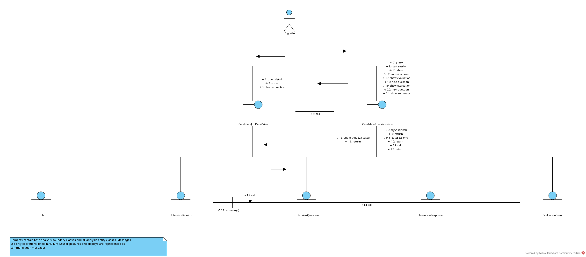

# Biểu đồ giao tiếp pha phân tích M4: Ôn tập và chấm phỏng vấn

**Bước 1.** Từ kịch bản chuẩn M4, xác định tác nhân là Ứng viên và hai lớp biên `CandidateJobDetailView`, `CandidateInterviewView` tương ứng các trang chi tiết tin tuyển dụng và luyện phỏng vấn. Các lớp thực thể được giữ đúng theo AN-M4 gồm `Job`, `InterviewSession`, `InterviewQuestion`, `InterviewResponse` và `EvaluationResult`.

**Bước 2.** Diễn giải luồng chính thành Kịch bản chuẩn V2 dưới đây. Các bước được đánh số liên tục; thông điệp trên biểu đồ khớp từng bước. Tên hàm chỉ sử dụng các hàm có trong AN-M4.

## Kịch bản chuẩn V2

1. Ứng viên mở chi tiết tin tuyển dụng trên lớp `CandidateJobDetailView`.
2. Lớp `CandidateJobDetailView` hiển thị chi tiết tin tuyển dụng cho Ứng viên.
3. Ứng viên chọn Ôn tập phỏng vấn trên lớp `CandidateJobDetailView`.
4. Lớp `CandidateJobDetailView` gọi lớp `CandidateInterviewView` để mở giao diện luyện phỏng vấn.
5. Lớp `CandidateInterviewView` gọi lớp `InterviewSession` để lấy danh sách phiên gần đây.
6. Lớp `InterviewSession` thực hiện hàm `mySessions()`.
7. Lớp `InterviewSession` trả kết quả danh sách phiên cho lớp `CandidateInterviewView`.
8. Lớp `CandidateInterviewView` hiển thị giao diện Luyện phỏng vấn cho Ứng viên.
9. Ứng viên chọn Bắt đầu phiên 6 câu trên lớp `CandidateInterviewView`.
10. Lớp `CandidateInterviewView` gọi lớp `InterviewSession` để tạo phiên.
11. Lớp `InterviewSession` thực hiện hàm `createSession()`.
12. Lớp `InterviewSession` trả kết quả phiên cho lớp `CandidateInterviewView`.
13. Lớp `CandidateInterviewView` hiển thị câu hỏi hiện tại và các thao tác phiên cho Ứng viên.
14. Ứng viên nhập câu trả lời và chọn Gửi & nhận đánh giá trên lớp `CandidateInterviewView`.
15. Lớp `CandidateInterviewView` gọi lớp `EvaluationResult` để gửi câu trả lời và nhận đánh giá.
16. Lớp `EvaluationResult` thực hiện hàm `submitAndEvaluate()`.
17. Lớp `EvaluationResult` gọi lớp `InterviewResponse` để ghi nhận câu trả lời.
18. Lớp `EvaluationResult` trả kết quả đánh giá cho lớp `CandidateInterviewView`.
19. Lớp `CandidateInterviewView` hiển thị kết quả đánh giá cho Ứng viên.
20. Ứng viên chọn Câu tiếp theo hoặc Xem tổng kết trên lớp `CandidateInterviewView`.
21. Lớp `CandidateInterviewView` gọi lớp `InterviewSession` để lấy tổng kết phiên.
22. Lớp `InterviewSession` thực hiện hàm `summary()`.
23. Lớp `InterviewSession` trả tổng kết cho lớp `CandidateInterviewView`.
24. Lớp `CandidateInterviewView` hiển thị tổng kết phiên cho Ứng viên.

**Bước 3.** Các đối tượng `:CandidateJobDetailView` và `:CandidateInterviewView` mang stereotype boundary; các đối tượng `:Job`, `:InterviewSession`, `:InterviewQuestion`, `:InterviewResponse` và `:EvaluationResult` mang stereotype entity. Các liên kết thể hiện trao đổi giữa tác nhân, giao diện và các lớp thực thể trong luồng chính.

**Bước 4.** Các thông điệp gọi hàm nghiệp vụ được ghi bằng đúng tên hàm trong AN-M4; hàm được thực hiện biểu diễn bằng self-message. Kịch bản không giả định trước kết quả AI hay nội dung/thứ tự câu hỏi.

Ta được biểu đồ giao tiếp pha phân tích chức năng Ôn tập và chấm phỏng vấn:

## Ghi chú truy vết và câu hỏi mở

- Các bước 1–4, 9, 13–15 và 19–20 truy vết tới `source/recruit_system/frontend/src/pages/candidate/CandidateJobDetailPage.tsx:129`, `:153`, `:156` và `source/recruit_system/frontend/src/pages/candidate/CandidateInterviewPage.tsx:31`, `:40`, `:44`, `:50`, `:70`, `:78`.
- `mySessions()`, `createSession()`, `submitAndEvaluate()` và `summary()` lần lượt truy vết tới `source/recruit_system/backend/interview-service/src/main/java/recruit/demo/service/InterviewService.java:132`, `:45`, `:106`, `:139`.
- **Open question:** AN-M4 không khai báo hàm có tên riêng cho việc mở một phiên đã lưu hoặc chuyển sang câu tiếp theo. Do đó, bước chọn Câu tiếp theo/Xem tổng kết chỉ được biểu diễn như thao tác trên giao diện; lời gọi được mô hình hóa trong luồng là `summary()` đã có trong AN-M4.
