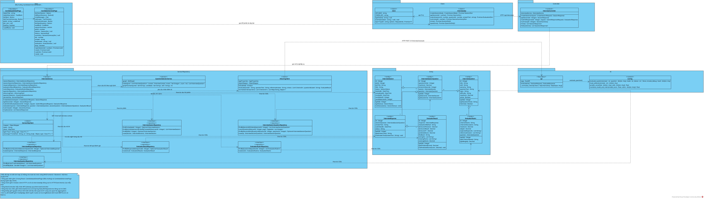

# Thiết kế biểu đồ lớp chi tiết chức năng M4: Ôn tập và chấm phỏng vấn (CLS-M4)

Biểu đồ lớp chi tiết tích hợp cả ba phân hệ Frontend, Backend và AI cho chức năng **M4: Ôn tập và chấm phỏng vấn** (Module 3 trong tài liệu dự án HireLens) trên một khung nhìn kiến trúc hợp nhất, tuân thủ quy chuẩn báo cáo môn Phân tích và Thiết kế Hệ thống Thông tin (mẫu PTIT).

Hệ thống được xây dựng trên các nền tảng công nghệ:
- **Frontend:** React 19 + Vite TypeScript, sử dụng React Hooks và React Router v7.
- **Backend:** Spring Boot 4.1 (Java 17), kiến trúc Microservices với dịch vụ chuyên biệt `interview-service` (cổng 8083, CSDL riêng `hirelens_interview`), truy xuất dữ liệu qua Spring Data JPA và Hibernate.
- **AI Service:** FastAPI (Python 3.11, cổng 8000), dịch vụ chấm điểm tự động tích hợp mô hình ngôn ngữ BERTScore kết hợp đối sánh barem tiêu chí (Rubric).

---

## Bước 1. Thiết kế tầng giao diện (View)

Chức năng M4 bao gồm hai giao diện chính của phân hệ ứng viên: màn hình xem chi tiết tin tuyển dụng (nơi dẫn nhập vào phiên luyện tập) và màn hình luyện phỏng vấn trực tiếp.

### 1. Trang chi tiết công việc (`CandidateJobDetailPage.tsx`)
- **Tập tin nguồn:** `source/recruit_system/frontend/src/pages/candidate/CandidateJobDetailPage.tsx:44`
- **Thuộc tính tường minh (Giao diện hiển thị):**
  - `txtJobTitle: string`: tiêu đề vị trí tuyển dụng hiển thị tại tiêu đề trang (`:70`).
  - `txtJobDescription: TextBlock`: khối văn bản trình bày chi tiết bản mô tả công việc (JD), phân đoạn theo dòng (`:98`).
  - `btnBack: Button`: liên kết quay lại trang danh sách đối sánh việc làm `/candidate/matching` (`:77`).
  - `btnPracticeInterview: Button`: nút hành động nổi bật "Ôn tập phỏng vấn", điều hướng ứng viên sang trang luyện tập kèm tham số ID công việc (`:154`).
- **Thuộc tính ẩn (Trạng thái & Context):**
  - `jobId: string | undefined`: mã định danh công việc lấy từ URL params (`:45`).
  - `job: Job | null`: đối tượng lưu trữ toàn bộ dữ liệu tin tuyển dụng sau khi tải từ backend (`:47`).
  - `loading: boolean`: cờ trạng thái biểu thị tiến trình tải dữ liệu trang (`:48`).
- **Tương tác Backend:** Gọi `jobsApi.get(id)` của `recruitment-service` để nạp thông tin công việc.
- **Điều hướng:**
  - Bấm `btnBack`: chuyển về `/candidate/matching`.
  - Bấm `btnPracticeInterview`: điều hướng sang `/candidate/interview?jobId={id}` (hoặc `/candidate/interview` nếu không có ID hợp lệ).

### 2. Trang luyện phỏng vấn (`CandidateInterviewPage.tsx`)
- **Tập tin nguồn:** `source/recruit_system/frontend/src/pages/candidate/CandidateInterviewPage.tsx:9`
- **Thuộc tính tường minh (Giao diện hiển thị):**
  - `btnStartSession: Button`: nút hành động trên thanh tiêu đề ("Bắt đầu phiên 6 câu" hoặc "Tạo phiên mới" tùy trạng thái phiên) (`:65`).
  - `tblRecentSessions: Button[]`: danh sách các nút bấm mở lại nhanh các phiên phỏng vấn gần đây của ứng viên (`:66`).
  - `chatMessages: Chat`: khung hội thoại mô phỏng buổi phỏng vấn, chứa các bong bóng thoại `ChatBubble` thể hiện câu hỏi của AI (`role="ai"`) và câu trả lời đã gửi của ứng viên (`role="user"`) (`:72`).
  - `txtAnswer: TextTextarea`: ô nhập liệu đa dòng cho phép ứng viên soạn câu trả lời (giới hạn tối đa 4.000 ký tự) (`:75`).
  - `btnSubmitAnswer: Button`: nút gửi câu trả lời và kích hoạt quy trình chấm điểm AI tức thì ("Gửi & nhận đánh giá") (`:77`).
  - `btnNextQuestion: Button`: nút chuyển sang câu hỏi kế tiếp hoặc xem báo cáo tổng kết khi đã hoàn thành phiên ("Câu tiếp theo" / "Xem tổng kết") (`:78`).
  - `evalBlock: EvalBlock`: component hiển thị kết quả đánh giá câu trả lời (vòng tròn điểm số, chỉ số BERTScore F1, độ phủ tiêu chí và nhận xét chi tiết) (`:81`).
  - `sessionSummary: section`: khối hiển thị tổng kết tiến độ toàn phiên, điểm trung bình và danh sách nhận xét từng câu (`:82`).
- **Thuộc tính ẩn (Trạng thái & Context):**
  - `jobId: number`: mã công việc trích xuất từ query parameter `jobId` trên URL (`:12`).
  - `session: SessionDto | null`: đối tượng phiên phỏng vấn hiện tại cùng danh sách câu hỏi (`:13`).
  - `history: SessionDto[]`: mảng danh sách các phiên luyện tập đã tạo của ứng viên (`:14`).
  - `summary: SessionSummaryDto | null`: đối tượng tổng kết điểm và các tiêu chí đã chấm của phiên (`:15`).
  - `idx: number`: chỉ số (index) câu hỏi đang được hiển thị trong phiên (`:16`).
  - `answer: string`: nội dung chuỗi câu trả lời ứng viên đang gõ trong form (`:17`).
  - `lastAnswer: string | null`: chuỗi lưu lại câu trả lời vừa gửi để hiển thị lại trên khung chat (`:18`).
  - `evaluation: EvaluationDto | null`: kết quả chấm điểm trả về từ backend cho câu hỏi hiện tại (`:19`).
  - `busy: boolean`: cờ vô hiệu hóa nút bấm và chống thao tác trùng lặp trong lúc đợi API xử lý (`:20`).
- **Tương tác Backend:** Gọi các hàm của module `interviewsApi` (`createSession`, `getSession`, `submit`, `summary`, `mine`).
- **Điều hướng & Vòng đời sự kiện:**
  - `openSession(id)`: nạp chi tiết phiên và báo cáo tổng kết, chuyển chỉ số `idx = session.currentIndex`.
  - `start()`: gọi tạo phiên mới 6 câu, cập nhật lại lịch sử `history`.
  - `submit()`: kiểm tra câu trả lời không rỗng, gửi nộp bài qua API, nhận kết quả đánh giá `evaluation`, đồng thời tải lại tổng kết phiên.
  - `next()`: tăng chỉ số câu hỏi sang câu tiếp theo, xóa trắng ô soạn thảo `answer` và ẩn kết quả chấm điểm câu cũ.

---

## Bước 2. Thiết kế tầng thao tác CSDL (Service/Repository — vai trò DAO)

Theo mô hình Spring Boot và Spring Data JPA, vai trò của tầng DAO truyền thống được đảm nhiệm bởi sự kết hợp giữa tầng dịch vụ nghiệp vụ (`InterviewService`, `QuestionSelectionService`) và các giao diện `Repository` kế thừa `JpaRepository`.

### 1. Lớp dịch vụ trung tâm `InterviewService`
- **Tập tin nguồn:** `source/recruit_system/backend/interview-service/src/main/java/recruit/demo/service/InterviewService.java:23`
- Quản lý toàn bộ vòng đời phiên luyện tập, kiểm soát phân quyền (`SecurityUtils.requireRole(Role.CANDIDATE)`), điều phối chọn câu hỏi và tích hợp chấm điểm AI.
- **Các phương thức:**
  - `createSession(request: CreateSessionRequest): SessionResponse` (`:45`)
    - *Input:* `CreateSessionRequest` (chứa `jobId`, `applicationId`, `questionIds`, `questionCount`).
    - *Output:* `SessionResponse` (thông tin phiên mới khởi tạo cùng trạng thái `CREATED`).
  - `getSession(id: Integer): SessionResponse` (`:98`)
    - *Input:* Mã phiên `id: Integer`.
    - *Output:* `SessionResponse` (dữ liệu phiên, vị trí câu hiện tại `currentIndex` và danh sách câu hỏi).
  - `submitAndEvaluate(sessionId: Integer, request: SubmitResponseRequest): EvaluationResponse` (`:106`)
    - *Input:* Mã phiên `sessionId: Integer`, DTO `SubmitResponseRequest` (gồm `questionId`, `answerText`).
    - *Output:* `EvaluationResponse` (kết quả chấm điểm gồm điểm dự đoán, độ phủ tiêu chí, nhận xét và các ý đạt/thiếu).
  - `evaluate(response: InterviewResponse, question: InterviewQuestion, sessionQuestion: InterviewSessionQuestion): EvaluationResult` (`:159`)
    - *Input:* Các thực thể `InterviewResponse`, `InterviewQuestion`, `InterviewSessionQuestion`.
    - *Output:* Thực thể `EvaluationResult` lưu kết quả vào CSDL sau khi gọi AI chấm điểm.
  - `summary(id: Integer): SessionSummary` (`:139`)
    - *Input:* Mã phiên `id: Integer`.
    - *Output:* DTO `SessionSummary` (số câu đã nộp, tổng số câu, điểm trung bình toàn phiên và danh sách đánh giá chi tiết).
  - `mySessions(): List<SessionResponse>` (`:132`)
    - *Input:* Không (lấy định danh ứng viên từ `SecurityUtils.currentUser()`).
    - *Output:* Danh sách `List<SessionResponse>` sắp xếp giảm dần theo thời gian tạo.

### 2. Dịch vụ chọn lọc câu hỏi `QuestionSelectionService`
- **Tập tin nguồn:** `source/recruit_system/backend/interview-service/src/main/java/recruit/demo/service/QuestionSelectionService.java:8`
- Thực thi thuật toán lựa chọn câu hỏi tất định theo đồ thị tri thức kỹ năng `SkillGraph`:
  - `select(pool: List<InterviewQuestion>, context: InterviewContext, recent: Set<Integer>, count: int): List<InterviewQuestion>` (`:26`)
    - *Input:* Ngân hàng câu hỏi `pool`, ngữ cảnh công việc/ứng viên `context`, tập mã câu hỏi gần đây `recent`, số lượng yêu cầu `count`.
    - *Output:* Danh sách `List<InterviewQuestion>` tối ưu theo độ tương thích kỹ năng và đa dạng chủ đề.
  - `graphScore(required: Set<String>, candidate: Set<String>, skill: String): int` (`:51`)
    - *Input:* Tập kỹ năng yêu cầu `required`, kỹ năng ứng viên `candidate`, kỹ năng của câu hỏi `skill`.
    - *Output:* Điểm số tương đồng khoảng cách ngữ nghĩa trên đồ thị `SkillGraph`.

### 3. Các Repository dữ liệu (Spring Data JPA — vai trò DAO cụ thể)
Mỗi repository quản lý một thực thể miền dữ liệu tương ứng trong CSDL `hirelens_interview`:
- **`InterviewSessionRepository`** (`InterviewSessionRepository.java:8`):
  - `findForUpdate(id: Integer): Optional<InterviewSession>` (`:13`): Khóa bi quan `@Lock(LockModeType.PESSIMISTIC_WRITE)` ngăn chặn nộp bài đồng thời hoặc xung đột ghi.
  - `findByCandidateUserIdOrderByCreatedAtDesc(userId: Integer): List<InterviewSession>` (`:10`): Truy vấn lịch sử phiên của ứng viên.
  - `findById(id: Integer): Optional<InterviewSession>` (`:8`): Tìm kiếm theo khóa chính.
  - `save(session: InterviewSession): InterviewSession` (`:8`): Thêm mới hoặc cập nhật phiên.
- **`InterviewSessionQuestionRepository`** (`InterviewSessionQuestionRepository.java:11`):
  - `findBySessionIdOrdered(sessionId: Integer): List<InterviewSessionQuestion>` (`:19`): Tải danh sách câu hỏi của phiên theo thứ tự `question_order ASC`.
  - `recentQuestionIds(userId: Integer, page: Pageable): List<Integer>` (`:22`): Lấy ID các câu hỏi đã làm gần đây để tránh lặp.
  - `findBySessionIdAndQuestionId(sessionId: Integer, questionId: Integer): Optional<InterviewSessionQuestion>` (`:24`): Kiểm tra tính hợp lệ của câu hỏi trong phiên.
  - `save(sq: InterviewSessionQuestion): InterviewSessionQuestion` (`:11`): Lưu liên kết câu hỏi - phiên.
- **`InterviewResponseRepository`** (`InterviewResponseRepository.java:8`):
  - `findBySessionQuestionId(sessionQuestionId: Integer): Optional<InterviewResponse>` (`:9`): Lấy bản ghi câu trả lời đã nộp.
  - `save(response: InterviewResponse): InterviewResponse` (`:8`): Lưu trữ câu trả lời của ứng viên.
- **`EvaluationResultRepository`** (`EvaluationResultRepository.java:8`):
  - `findByResponseId(responseId: Integer): Optional<EvaluationResult>` (`:9`): Truy vấn kết quả đánh giá của câu trả lời.
  - `save(result: EvaluationResult): EvaluationResult` (`:8`): Lưu bản ghi chấm điểm AI.
- **`EvaluationRubricRepository`** (`EvaluationRubricRepository.java:8`):
  - `findByQuestionId(questionId: Integer): List<EvaluationRubric>` (`:9`): Tải barem chấm điểm chi tiết (tiêu chí, trọng số, gợi ý) của câu hỏi.
  - `save(rubric: EvaluationRubric): EvaluationRubric` (`:8`): Cập nhật thông tin barem.
- **`InterviewQuestionRepository`** (`InterviewQuestionRepository.java:8`):
  - `findByActiveTrueOrderByIdAsc(): List<InterviewQuestion>` (`:11`): Lấy ngân hàng các câu hỏi đang khả dụng.
  - `findAllById(ids: Iterable<Integer>): List<InterviewQuestion>` (`:8`): Tải tập câu hỏi theo danh sách ID chọn trước.

---

## Bước 3. Thiết kế tầng thực thể (Entity)

Tầng thực thể tái sử dụng thiết kế chuẩn hóa từ biểu đồ thiết kế thực thể `E1`, bao gồm 6 thực thể nòng cốt thuộc CSDL `hirelens_interview`:
1. **`InterviewSession`** (`InterviewSession.java:16`): Thực thể phiên luyện tập, lưu trạng thái (`SessionStatus`), thời điểm bắt đầu/hoàn thành và định danh logic liên kết sang ứng viên (`candidateId`, `candidateUserId`) và công việc (`jobId`, `jobTitle`).
2. **`InterviewQuestion`** (`InterviewQuestion.java:17`): Thực thể ngân hàng câu hỏi, chứa nội dung câu hỏi `questionText`, chủ đề `topic`, độ khó `difficulty`, kỹ năng `skill`, cấp độ `seniority` và cờ kích hoạt `active`.
3. **`InterviewSessionQuestion`** (`InterviewSessionQuestion.java:15`): Thực thể liên kết n-n giữa phiên và câu hỏi, xác định thứ tự câu hỏi `questionOrder`, điểm tối đa `maxScore` và thời gian làm bài `timeLimitSeconds`.
4. **`InterviewResponse`** (`InterviewResponse.java:16`): Thực thể câu trả lời ứng viên nộp cho một câu hỏi trong phiên (`answerText`, `submittedAt`, `status`).
5. **`EvaluationResult`** (`EvaluationResult.java:20`): Thực thể kết quả đánh giá chấm điểm AI, chứa điểm dự đoán `predictedScore`, chỉ số BERTScore (`bertscorePrecision`, `bertscoreRecall`, `bertscoreF1`), tỷ lệ độ phủ tiêu chí `coverageScore`, nhận xét `feedback` cùng danh sách ý đạt `strengths` và ý thiếu `missingPoints`.
6. **`EvaluationRubric`** (`EvaluationRubric.java:20`): Thực thể barem tiêu chí chấm điểm của từng câu hỏi, chứa tên tiêu chí `criterionName`, mô tả `criterionDescription`, trọng số `weight`, từ khóa mong đợi `expectedKeywords` và đáp án mẫu `referenceAnswers`.

Các quan hệ thành phần (Aggregation ◇—) giữa các thực thể được giữ nguyên vẹn từ `E1`:
- `InterviewSession` (1) ◇— (n) `InterviewSessionQuestion`
- `InterviewQuestion` (1) ◇— (n) `InterviewSessionQuestion`
- `InterviewQuestion` (1) ◇— (n) `EvaluationRubric`
- `InterviewSessionQuestion` (1) ◇— (1) `InterviewResponse`
- `InterviewResponse` (1) ◇— (1) `EvaluationResult`

---

## Bước 4. Thiết kế các lớp phụ trợ (Client, Controller, Service-to-Service, AI)

### 1. Tầng Client Frontend (`api/client.ts`)
- **`ApiClient` (`client`)** (`client.ts:32`): Lớp client HTTP cơ sở tương đương vai trò `HTTPClient.fetch()` trong mẫu PTIT. Quản lý `API_BASE`, token xác thực trong `localStorage` (`getToken()`, `setToken()`), và hàm generic `api<T>(path, options)` tự động đính kèm header `Authorization: Bearer <token>`.
- **`interviewsApi`** (`client.ts:125`): Module Facade đóng gói các lời gọi API REST hướng tới endpoint `/api/interviews` của backend.

### 2. Tầng REST Controller (`InterviewController.java`)
- **`InterviewController`** (`InterviewController.java:14`): REST Controller công khai của `interview-service` (prefix `@RequestMapping("/api/interviews")`), đóng vai trò tiếp nhận và điều phối các HTTP request gửi đến từ Nginx API Gateway.
- Điều phối các yêu cầu: `POST /sessions` (tạo phiên), `GET /sessions/{id}` (lấy chi tiết), `POST /sessions/{id}/responses` (nộp câu trả lời), `GET /sessions/{id}/summary` (xem tổng kết), `GET /sessions/mine` (lịch sử).

### 3. Tầng tích hợp Service-to-Service và Client AI
- **`ServiceHttpClient`** (`ServiceHttpClient.java:13` trong `backend/common`): Client HTTP nội bộ dùng chung giữa các microservices. Tự động đính kèm header bí mật `X-Service-Token` để gọi API nội bộ `/internal/interview-context` sang `recruitment-service` nhằm lấy hồ sơ ứng viên và thông tin tin tuyển dụng.
- **`AiScoringClient`** (`AiScoringClient.java:26`): Adapter HTTP Client gọi sang dịch vụ FastAPI `interview-ai`. Kiểm tra cấu hình bật/tắt AI (`isEnabled()`), chuẩn hóa trọng số barem (`normalizeCriteria()`), gửi HTTP POST tới endpoint `/v1/interview/evaluate` và phân tích kết quả trả về `EvaluateResult`. Nếu AI gặp sự cố, hệ thống chủ động ném lỗi `ApiException` thay vì fallback âm thầm.

### 4. Dịch vụ AI FastAPI (`AI/src/`)
- **`FastApiApp` (`api`)** (`api.py:35`): Ứng dụng FastAPI định tuyến endpoint `@app.post("/v1/interview/evaluate")`, tiếp nhận request chấm điểm `EvaluateRequest`, chuẩn hóa tiêu chí barem và trả về `EvaluateResponse`.
- **`ScoringModule` (`scoring`)** (`scoring.py:17`): Module tính toán lõi, gọi hàm `evaluate_question()`, tải hệ số hiệu chuẩn `load_calibration()`, dự đoán điểm số `predict_score()` và kết hợp điểm mô hình với độ phủ barem `combine_model_and_rubric()`.

---

## Bước 5. Thiết lập liên kết phân tầng tổng thể

Luồng điều khiển và trao đổi dữ liệu giữa các thành phần diễn ra xuyên suốt qua 5 tầng chính:
1. **Giao diện (View) $\rightarrow$ Client:** `CandidateInterviewPage` gọi các hàm nghiệp vụ của `interviewsApi`, `interviewsApi` ủy nhiệm cho `client.api<T>()`.
2. **Client $\rightarrow$ Controller:** `interviewsApi` gửi các HTTP request (`GET`, `POST`) qua giao thức mạng tới `InterviewController` trên endpoint `/api/interviews/*`.
3. **Controller $\rightarrow$ Service:** `InterviewController` chuyển giao tham số đầu vào và điều phối xử lý tới `InterviewService`.
4. **Service $\rightarrow$ Repositories & Clients:**
   - `InterviewService` gọi `QuestionSelectionService` để chọn câu hỏi theo đồ thị tri thức.
   - `InterviewService` gọi `ServiceHttpClient` để lấy ngữ cảnh từ `recruitment-service`.
   - `InterviewService` thao tác dữ liệu qua 6 `XxxRepository`.
   - `InterviewService` ủy nhiệm yêu cầu chấm điểm cho `AiScoringClient`.
5. **Repositories $\rightarrow$ Entity:** Các repository thực hiện các lệnh truy vấn/cập nhật JPA trực tiếp lên các thực thể `InterviewSession`, `InterviewQuestion`, `InterviewSessionQuestion`, `InterviewResponse`, `EvaluationResult`, `EvaluationRubric`.
6. **Client AI $\rightarrow$ FastAPI AI:** `AiScoringClient` gửi HTTP POST tới `FastApiApp.evaluate()`, từ đó gọi `ScoringModule.evaluate_question()` để thực thi giải thuật BERTScore và Rubric.

Ta được biểu đồ lớp chi tiết chức năng Ôn tập và chấm phỏng vấn:

---

## Phân tích các mẫu thiết kế (Design Patterns) thực sự có trong mã nguồn

Kiến trúc chức năng M4 của HireLens áp dụng các mẫu thiết kế hướng đối tượng chuẩn mực:

### 1. Repository Pattern (Spring Data JPA)
- **Các lớp tham gia:** `InterviewSessionRepository`, `InterviewSessionQuestionRepository`, `InterviewResponseRepository`, `EvaluationResultRepository`, `EvaluationRubricRepository`, `InterviewQuestionRepository`.
- **Vai trò:** Cô lập hoàn toàn tầng dịch vụ nghiệp vụ khỏi chi tiết cài đặt của hệ quản trị CSDL quan hệ PostgreSQL. Cung cấp các thao tác trừu tượng dạng collection hướng đối tượng (`findById`, `save`, `findBySessionIdOrdered`).
- **Ưu điểm cho HireLens:** Giúp mã nguồn nghiệp vụ trong `InterviewService` không bị phụ thuộc vào các câu lệnh SQL thuần, dễ dàng quản lý giao dịch (@Transactional) và nâng cao khả năng kiểm thử tự động.

### 2. Data Transfer Object (DTO) Pattern
- **Các lớp tham gia:** `CreateSessionRequest`, `SessionResponse`, `SubmitResponseRequest`, `EvaluationResponse` (Backend) và `SessionDto`, `EvaluationDto`, `SessionSummaryDto` (Frontend).
- **Vai trò:** Đóng gói dữ liệu trao đổi qua ranh giới mạng giữa Frontend, Backend và AI. Các DTO backend được triển khai dưới dạng Java `record` bất biến.
- **Ưu điểm cho HireLens:** Giấu kín các chi tiết nhạy cảm của thực thể JPA (như phiên bản bản ghi, quan hệ nội bộ), giảm thiểu lưu lượng mạng truyền tải và ngăn chặn tấn công Over-posting.

### 3. Dependency Injection (DI) & Inversion of Control (IoC)
- **Các lớp tham gia:** `InterviewController`, `InterviewService`, `AiScoringClient`, `QuestionSelectionService`, `ToastContext`.
- **Vai trò:** Spring Container tự động tiêm các dependency thông qua constructor (Lombok `@RequiredArgsConstructor`). Phía React sử dụng React Context (`ToastContext`) và custom hook `useToast()` để cung cấp chức năng thông báo mà không cần prop drilling.
- **Ưu điểm cho HireLens:** Giảm độ liên kết ràng buộc (loose coupling), tăng tính mô-đun hóa và dễ dàng thay thế các mock client khi chạy unit test.

### 4. Gateway / Adapter Pattern
- **Các lớp tham gia:** `interviewsApi`, `ApiClient` (Frontend) và `AiScoringClient`, `ServiceHttpClient` (Backend).
- **Vai trò:** `ApiClient` đóng vai trò Gateway giao tiếp HTTP cho tầng giao diện. `AiScoringClient` và `ServiceHttpClient` đóng vai trò Adapter chuyển đổi giữa mô hình đối tượng Java của `interview-service` sang dữ liệu JSON REST API của các dịch vụ bên ngoài (`recruitment-service` và `interview-ai`).
- **Ưu điểm cho HireLens:** Chuẩn hóa các chính sách bảo mật (đính kèm JWT Bearer hoặc `X-Service-Token`), xử lý tập trung mã lỗi HTTP và đảm bảo tính nhất quán của kết nối mạng.

### 5. Strategy & Heuristic Heuristic Selection Pattern
- **Các lớp tham gia:** `QuestionSelectionService`, `SkillGraph`.
- **Vai trò:** Thuật toán lựa chọn câu hỏi phỏng vấn được tách riêng thành một chiến lược tính điểm đa tiêu chí: ưu tiên trùng khớp kỹ năng JD/CV, duyệt khoảng cách tri thức trên đồ thị `SkillGraph`, phạt độ lệch thâm niên và phạt lặp lại câu hỏi gần đây.
- **Ưu điểm cho HireLens:** Dễ dàng tinh chỉnh, bảo trì hoặc thay thế thuật toán chọn câu hỏi mà không làm ảnh hưởng đến luồng điều phối vòng đời phiên trong `InterviewService`.

### 6. Pessimistic Locking Pattern
- **Các lớp tham gia:** `InterviewSessionRepository.findForUpdate()`.
- **Vai trò:** Áp dụng khóa bi quan `@Lock(LockModeType.PESSIMISTIC_WRITE)` (`SELECT ... FOR UPDATE`) khi ứng viên nộp câu trả lời trong `submitAndEvaluate()`.
- **Ưu điểm cho HireLens:** Đảm bảo tính toàn vẹn dữ liệu, ngăn chặn triệt để tình trạng ứng viên mở đồng thời nhiều tab trình duyệt để gửi nhiều câu trả lời cùng lúc cho một phiên phỏng vấn.

---

## Bảng đối chiếu truy vết nguồn (Traceability Table)

| Thành phần | Lớp / Giao diện | Vị trí tập tin nguồn | Dòng |
|---|---|---|---|
| **View (FE)** | `CandidateJobDetailPage` | `source/recruit_system/frontend/src/pages/candidate/CandidateJobDetailPage.tsx` | 44 |
| **View (FE)** | `CandidateInterviewPage` | `source/recruit_system/frontend/src/pages/candidate/CandidateInterviewPage.tsx` | 9 |
| **Client (FE)** | `ApiClient` (`client`) | `source/recruit_system/frontend/src/api/client.ts` | 32 |
| **Client (FE)** | `interviewsApi` | `source/recruit_system/frontend/src/api/client.ts` | 125 |
| **Controller (BE)** | `InterviewController` | `source/recruit_system/backend/interview-service/src/main/java/recruit/demo/controller/InterviewController.java` | 14 |
| **Service (BE)** | `InterviewService` | `source/recruit_system/backend/interview-service/src/main/java/recruit/demo/service/InterviewService.java` | 23 |
| **Service (BE)** | `QuestionSelectionService` | `source/recruit_system/backend/interview-service/src/main/java/recruit/demo/service/QuestionSelectionService.java` | 8 |
| **Client (BE)** | `AiScoringClient` | `source/recruit_system/backend/interview-service/src/main/java/recruit/demo/service/AiScoringClient.java` | 26 |
| **Client (BE)** | `ServiceHttpClient` | `source/recruit_system/backend/common/src/main/java/recruit/demo/client/ServiceHttpClient.java` | 13 |
| **Repository (BE)** | `InterviewSessionRepository` | `source/recruit_system/backend/interview-service/src/main/java/recruit/demo/repository/InterviewSessionRepository.java` | 8 |
| **Repository (BE)** | `InterviewSessionQuestionRepository` | `source/recruit_system/backend/interview-service/src/main/java/recruit/demo/repository/InterviewSessionQuestionRepository.java` | 11 |
| **Repository (BE)** | `InterviewResponseRepository` | `source/recruit_system/backend/interview-service/src/main/java/recruit/demo/repository/InterviewResponseRepository.java` | 8 |
| **Repository (BE)** | `EvaluationResultRepository` | `source/recruit_system/backend/interview-service/src/main/java/recruit/demo/repository/EvaluationResultRepository.java` | 8 |
| **Repository (BE)** | `EvaluationRubricRepository` | `source/recruit_system/backend/interview-service/src/main/java/recruit/demo/repository/EvaluationRubricRepository.java` | 8 |
| **Repository (BE)** | `InterviewQuestionRepository` | `source/recruit_system/backend/interview-service/src/main/java/recruit/demo/repository/InterviewQuestionRepository.java` | 8 |
| **Entity (BE)** | `InterviewSession` | `source/recruit_system/backend/interview-service/src/main/java/recruit/demo/entity/InterviewSession.java` | 16 |
| **Entity (BE)** | `InterviewSessionQuestion` | `source/recruit_system/backend/interview-service/src/main/java/recruit/demo/entity/InterviewSessionQuestion.java` | 15 |
| **Entity (BE)** | `InterviewQuestion` | `source/recruit_system/backend/interview-service/src/main/java/recruit/demo/entity/InterviewQuestion.java` | 17 |
| **Entity (BE)** | `InterviewResponse` | `source/recruit_system/backend/interview-service/src/main/java/recruit/demo/entity/InterviewResponse.java` | 16 |
| **Entity (BE)** | `EvaluationResult` | `source/recruit_system/backend/interview-service/src/main/java/recruit/demo/entity/EvaluationResult.java` | 20 |
| **Entity (BE)** | `EvaluationRubric` | `source/recruit_system/backend/interview-service/src/main/java/recruit/demo/entity/EvaluationRubric.java` | 20 |
| **AI** | `FastApiApp` (`api`) | `source/recruit_system/AI/src/api.py` | 35 |
| **AI** | `ScoringModule` (`scoring`) | `source/recruit_system/AI/src/scoring.py` | 17 |

---

## Ghi chú & Câu hỏi mở (Open Questions)

- **Mâu thuẫn tài liệu – source code:** Báo cáo v6 mô tả backend đơn khối dùng chung CSDL; mã nguồn thực tế ở commit `1c96706` triển khai microservices hoàn chỉnh với CSDL `hirelens_interview` tách biệt. `interview-service` giao tiếp với `recruitment-service` qua API nội bộ HTTP mang header `X-Service-Token`, không có khóa ngoại hay quan hệ đối tượng JPA trực tiếp xuyên CSDL. Biểu đồ chi tiết phản ánh trung thực kiến trúc mã nguồn thực tế.
- **Open Questions:** Không có câu hỏi tồn đọng (0 open questions). Toàn bộ lớp, thuộc tính, chữ ký phương thức và quan hệ phân tầng đã được đối chiếu 100% chính xác với mã nguồn thực tế.
