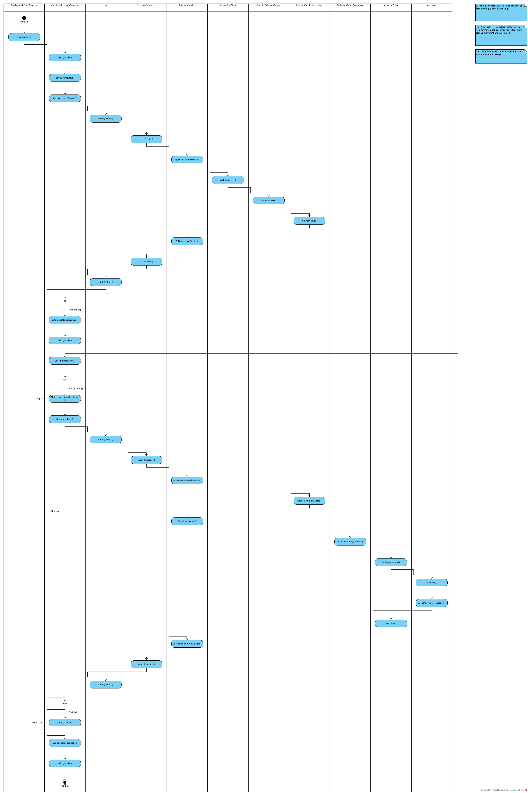

# Biểu đồ hoạt động chức năng Ôn tập và chấm phỏng vấn

**Bước 1.** Từ các lớp giao diện trong CLS-M4, xác định hai làn `CandidateJobDetailPage.tsx` và `CandidateInterviewPage.tsx`. Bổ sung các làn `client`, `InterviewController`, `InterviewService`, `ServiceHttpClient`, `QuestionSelectionService`, `InterviewSessionRepository`, `EvaluationRubricRepository`, `AiScoringClient` và `interview-ai`. Module `client` và hàm `api<T>()`/`fetch()` đảm nhiệm vai trò HTTPClient; các handler của `InterviewController` đảm nhiệm vai trò requestMapping; service và repository đảm nhiệm vai trò thao tác dữ liệu.

**Bước 2.** Xác định các action và luồng điều khiển trong phạm vi tạo phiên và chấm một câu trả lời:

1. **`CandidateJobDetailPage.tsx`:** Hiện giao diện chi tiết; chọn Ôn tập phỏng vấn để mở trang luyện tập (`source/recruit_system/frontend/src/pages/candidate/CandidateJobDetailPage.tsx:65`, `:154`).
2. **`CandidateInterviewPage.tsx`:** Hiện giao diện; lấy `jobId` từ tham số URL; gọi `createSession()`; lưu `session`, `idx` vào state; hiện câu hỏi; lấy `answer` từ form. Nếu câu trả lời không hợp lệ, thông báo “Hãy nhập câu trả lời”; nếu hợp lệ, gọi `submit()`. Khi chấm thành công lưu `evaluation` và hiện kết quả; khi thất bại thông báo lỗi (`source/recruit_system/frontend/src/pages/candidate/CandidateInterviewPage.tsx:12`, `:31`, `:40`, `:64`).
3. **`client`:** `api<T>()` thực hiện `fetch()` cho các yêu cầu tạo phiên, nộp câu trả lời và trả kết quả theo từng lượt (`source/recruit_system/frontend/src/api/client.ts:32`, `:43`, `:135`, `:140`).
4. **`InterviewController`:** `createSession()` và `submitResponse()` tiếp nhận request và trả kết quả từ service (`source/recruit_system/backend/interview-service/src/main/java/recruit/demo/controller/InterviewController.java:23`, `:39`).
5. **`InterviewService`:** Gọi `createSession()`, `submitAndEvaluate()` và `evaluate()`; lấy ngữ cảnh, chọn câu, lưu phiên, lấy rubric và gọi chấm điểm (`source/recruit_system/backend/interview-service/src/main/java/recruit/demo/service/InterviewService.java:45`, `:106`, `:159`).
6. **`ServiceHttpClient`:** Gọi `get<T>()` lấy ngữ cảnh; **`QuestionSelectionService`:** gọi `select()` để chọn câu (`source/recruit_system/backend/interview-service/src/main/java/recruit/demo/service/InterviewService.java:51`, `:68`).
7. **`InterviewSessionRepository`:** Gọi `save()` khi tạo phiên và `findForUpdate()` khi nộp bài; **`EvaluationRubricRepository`:** gọi `findByQuestionId()` lấy barem (`source/recruit_system/backend/interview-service/src/main/java/recruit/demo/service/InterviewService.java:83`, `:108`, `:165`).
8. **`AiScoringClient` và `interview-ai`:** Gọi `evaluate()` tới endpoint `evaluate()`, sau đó `evaluate_question()` và trả kết quả về các tầng (`source/recruit_system/backend/interview-service/src/main/java/recruit/demo/service/InterviewService.java:169`, `source/recruit_system/AI/src/api.py:205`, `:222`).

Các action lặp tên ở chiều ngược lại thể hiện kết quả trở về, không phải thêm một yêu cầu mới. Guard tại nút quyết định phân biệt thành công/thất bại và câu trả lời hợp lệ/không hợp lệ. Luồng lỗi quay lại giao diện luyện tập; dữ liệu đã lưu trước lỗi tải lại không bị giả định là hoàn tác.

Ta được biểu đồ hoạt động:

**Giới hạn và câu hỏi mở:** Để không vượt quá 40 node, biểu đồ chỉ khai triển một lượt tạo phiên và chấm một câu; các thao tác tải lịch sử, mở phiên, tải lại phiên/tổng kết/lịch sử sau chấm, chuyển câu và các lời gọi repository phụ được lược bỏ. Không coi hiển thị đánh giá là đã tải thành công tổng kết. `jobsApi.get()` và các lớp backend tải tin thực sự có trong source nhưng không nằm trong CLS-M4; vì yêu cầu chỉ dùng hàm trong CLS-M4, luồng tải chi tiết tin không được khai triển. Cần xác nhận có bổ sung chúng vào CLS-M4 và cho phép tách biểu đồ để thể hiện toàn bộ kịch bản hay không.
