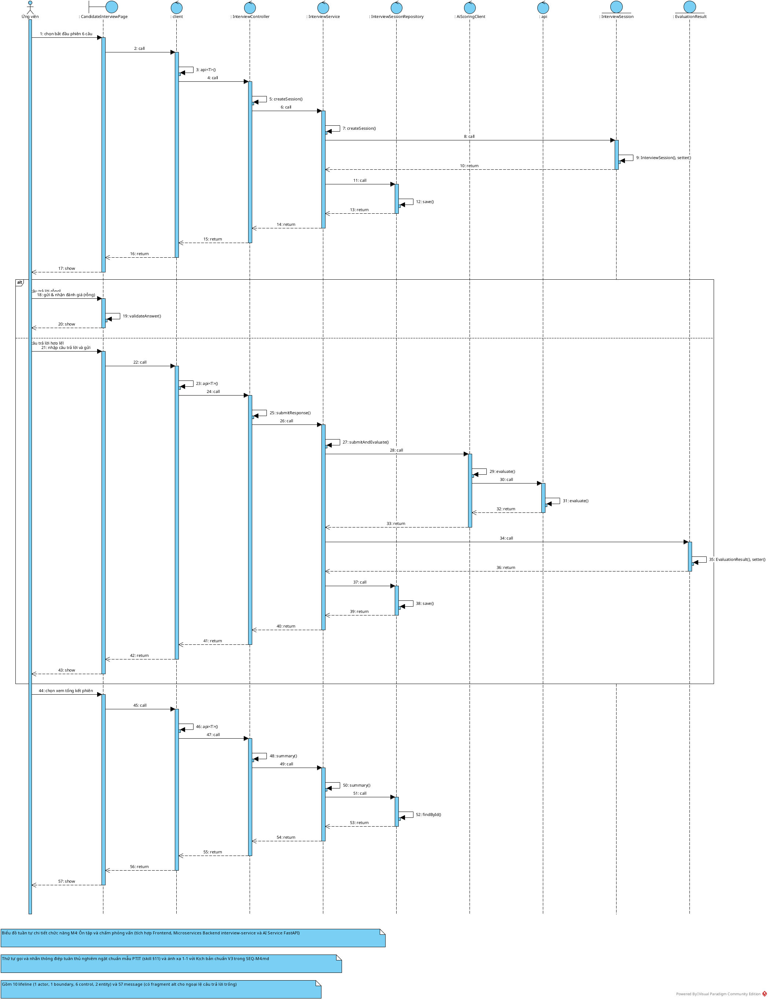

# Thiết kế biểu đồ tuần tự chức năng M4: Ôn tập và chấm phỏng vấn (SEQ-M4)

Biểu đồ tuần tự chi tiết chức năng **M4: Ôn tập và chấm phỏng vấn** (Module 3 trong tài liệu hệ thống HireLens) được xây dựng theo quy chuẩn báo cáo môn Phân tích và Thiết kế Hệ thống Thông tin (mẫu PTIT, skill §11). Biểu đồ tích hợp luồng tương tác xuyên suốt 4 tầng kiến trúc phân tán gồm: Giao diện người dùng (React 19 TypeScript), HTTP Client, Backend Microservice (`interview-service` Spring Boot 4.1, CSDL `hirelens_interview`), Tầng truy xuất dữ liệu Spring Data JPA và Dịch vụ AI chấm điểm chuyên biệt (FastAPI Python).

---

## Bước 1. Xác định tác nhân và các đối tượng tham gia tương tác

Từ biểu đồ lớp chi tiết `CLS-M4` và kịch bản chuẩn `KB-M4`, các thành phần tham gia tương tác trong chu trình luyện tập và chấm điểm phỏng vấn bao gồm:
1. **Tác nhân trực tiếp:** `Ứng viên` (`Candidate`) đóng vai trò người thực hiện các hành động luyện phỏng vấn trực tiếp trên hệ thống.
2. **Tầng giao diện (Boundary):**
   - `:CandidateInterviewPage`: Trang giao diện luyện phỏng vấn trực tiếp (`source/recruit_system/frontend/src/pages/candidate/CandidateInterviewPage.tsx:9`), phụ trách điều khiển luồng hiển thị câu hỏi, nhận diện câu trả lời, gửi nộp bài và trình bày báo cáo đánh giá.
3. **Tầng phụ trợ & điều khiển (Control):**
   - `:client`: Module HTTP Client frontend (`source/recruit_system/frontend/src/api/client.ts:32`), thực thi hàm `api<T>()` đóng gói cấu hình xác thực JWT và chuyển tiếp yêu cầu HTTP REST qua API Gateway.
   - `:InterviewController`: Bộ điều khiển REST Controller phía backend (`source/recruit_system/backend/interview-service/src/main/java/recruit/demo/controller/InterviewController.java:14`), tiếp nhận và định tuyến các endpoint `/api/interviews/sessions/**`.
   - `:InterviewService`: Lớp dịch vụ nghiệp vụ cốt lõi (`source/recruit_system/backend/interview-service/src/main/java/recruit/demo/service/InterviewService.java:23`), quản lý toàn bộ vòng đời phiên phỏng vấn, kiểm soát phân quyền ứng viên, điều phối chọn lọc câu hỏi và phối hợp quy trình chấm điểm AI.
   - `:InterviewSessionRepository`: Giao diện truy xuất dữ liệu CSDL Spring Data JPA (`source/recruit_system/backend/interview-service/src/main/java/recruit/demo/repository/InterviewSessionRepository.java:8`), đảm nhiệm vai trò DAO thao tác trực tiếp với bảng dữ liệu `interview_sessions`.
   - `:AiScoringClient`: Client tích hợp HTTP nội bộ (`source/recruit_system/backend/interview-service/src/main/java/recruit/demo/service/AiScoringClient.java:26`), chuyển tiếp payload câu trả lời và barem tiêu chí sang dịch vụ AI.
   - `:api`: Ứng dụng dịch vụ AI FastAPI (`source/recruit_system/AI/src/api.py:35`), tiếp nhận yêu cầu chấm điểm qua endpoint `/v1/interview/evaluate` và thực thi thuật toán đối sánh ngữ nghĩa BERTScore kết hợp rubric.
4. **Tầng thực thể (Entity):**
   - `:InterviewSession`: Thực thể phiên phỏng vấn lưu trữ trạng thái, thời gian và thông tin công việc liên kết (`source/recruit_system/backend/interview-service/src/main/java/recruit/demo/entity/InterviewSession.java:16`).
   - `:EvaluationResult`: Thực thể kết quả đánh giá lưu trữ điểm số dự đoán, độ phủ tiêu chí và nhận xét chi tiết (`source/recruit_system/backend/interview-service/src/main/java/recruit/demo/entity/EvaluationResult.java:20`).

---

## Bước 2. Xây dựng Kịch bản chuẩn V3

Kịch bản chuẩn V3 mở rộng kịch bản phân tích V2, mô tả chi tiết và đánh số liên tục 57 bước tương tác từ giao diện React qua các tầng mạng, controller, service, repository, client AI đến tầng thực thể CSDL:

### Giai đoạn 1: Khởi tạo phiên phỏng vấn mới (6 câu hỏi)
1. Ứng viên chọn "Bắt đầu phiên 6 câu" trên trang `:CandidateInterviewPage`.
2. Trang `:CandidateInterviewPage` gọi `:client` để yêu cầu tạo phiên mới.
3. `:client` tự thực hiện hàm `api<T>()` để cấu hình header và token xác thực.
4. `:client` gửi yêu cầu HTTP POST `/api/interviews/sessions` tới `:InterviewController`.
5. `:InterviewController` tự thực hiện phương thức xử lý `createSession()`.
6. `:InterviewController` gọi phương thức `createSession()` của `:InterviewService`.
7. `:InterviewService` tự thực hiện hàm nghiệp vụ `createSession()`, nạp ngữ cảnh và lựa chọn bộ câu hỏi.
8. `:InterviewService` gọi thực thể `:InterviewSession` để khởi tạo đối tượng phiên mới.
9. `:InterviewSession` tự thực hiện phương thức khởi tạo và các hàm gán dữ liệu `InterviewSession(), setter()`.
10. `:InterviewSession` trả về thực thể phiên đã khởi tạo cho `:InterviewService`.
11. `:InterviewService` gọi `:InterviewSessionRepository` để lưu trữ phiên vào CSDL.
12. `:InterviewSessionRepository` tự thực hiện câu lệnh lưu dữ liệu `save()`.
13. `:InterviewSessionRepository` trả về thực thể phiên đã lưu thành công cho `:InterviewService`.
14. `:InterviewService` trả đối tượng `SessionResponse` cho `:InterviewController`.
15. `:InterviewController` trả kết quả phản hồi HTTP cho `:client`.
16. `:client` trả kết quả dữ liệu phiên cho trang `:CandidateInterviewPage`.
17. Trang `:CandidateInterviewPage` hiển thị nội dung câu hỏi đầu tiên của phiên cho Ứng viên (`show`).

### Giai đoạn 2: Nộp câu trả lời và Chấm điểm qua AI (kèm khối rẽ nhánh ngoại lệ `alt`)
- **[Nhánh ngoại lệ: Câu trả lời rỗng (Ngoại lệ 7.1)]**
18. Ứng viên để trống ô nhập liệu và chọn "Gửi & nhận đánh giá" trên `:CandidateInterviewPage`.
19. Trang `:CandidateInterviewPage` tự thực hiện kiểm tra biểu mẫu `validateAnswer()`.
20. Trang `:CandidateInterviewPage` hiển thị thông báo lỗi "Hãy nhập câu trả lời" cho Ứng viên (`show`).
- **[Nhánh chuẩn: Câu trả lời hợp lệ]**
21. Ứng viên nhập nội dung câu trả lời và chọn "Gửi & nhận đánh giá" trên `:CandidateInterviewPage`.
22. Trang `:CandidateInterviewPage` gọi `:client` để gửi câu trả lời.
23. `:client` tự thực hiện hàm `api<T>()`.
24. `:client` gửi yêu cầu HTTP POST `/api/interviews/sessions/{id}/responses` tới `:InterviewController`.
25. `:InterviewController` tự thực hiện phương thức xử lý `submitResponse()`.
26. `:InterviewController` gọi phương thức `submitAndEvaluate()` của `:InterviewService`.
27. `:InterviewService` tự thực hiện hàm nghiệp vụ `submitAndEvaluate()`, kiểm tra phiên và nạp rubric câu hỏi.
28. `:InterviewService` gọi `:AiScoringClient` để kích hoạt quy trình chấm điểm AI.
29. `:AiScoringClient` tự thực hiện phương thức `evaluate()`, chuẩn hóa payload JSON.
30. `:AiScoringClient` gửi yêu cầu HTTP POST `/v1/interview/evaluate` tới dịch vụ FastAPI `:api`.
31. Dịch vụ `:api` tự thực hiện hàm `evaluate()`, tính toán điểm tương đồng BERTScore và rubric.
32. Dịch vụ `:api` trả kết quả JSON đánh giá cho `:AiScoringClient`.
33. `:AiScoringClient` trả đối tượng `EvaluateResult` cho `:InterviewService`.
34. `:InterviewService` gọi thực thể `:EvaluationResult` để khởi tạo kết quả đánh giá.
35. `:EvaluationResult` tự thực hiện phương thức khởi tạo và các hàm gán dữ liệu `EvaluationResult(), setter()`.
36. `:EvaluationResult` trả về đối tượng kết quả cho `:InterviewService`.
37. `:InterviewService` gọi `:InterviewSessionRepository` để cập nhật trạng thái phiên phỏng vấn.
38. `:InterviewSessionRepository` tự thực hiện phương thức `save()`.
39. `:InterviewSessionRepository` trả về trạng thái phiên đã cập nhật cho `:InterviewService`.
40. `:InterviewService` trả đối tượng `EvaluationResponse` cho `:InterviewController`.
41. `:InterviewController` trả kết quả phản hồi HTTP cho `:client`.
42. `:client` trả kết quả đánh giá cho trang `:CandidateInterviewPage`.
43. Trang `:CandidateInterviewPage` hiển thị kết quả đánh giá chi tiết (EvalBlock) cho Ứng viên (`show`).

### Giai đoạn 3: Xem báo cáo tổng kết phiên luyện tập
44. Ứng viên chọn "Xem tổng kết phiên" trên trang `:CandidateInterviewPage`.
45. Trang `:CandidateInterviewPage` gọi `:client` để lấy báo cáo tổng kết.
46. `:client` tự thực hiện hàm `api<T>()`.
47. `:client` gửi yêu cầu HTTP GET `/api/interviews/sessions/{id}/summary` tới `:InterviewController`.
48. `:InterviewController` tự thực hiện phương thức xử lý `summary()`.
49. `:InterviewController` gọi phương thức `summary()` của `:InterviewService`.
50. `:InterviewService` tự thực hiện hàm nghiệp vụ `summary()`.
51. `:InterviewService` gọi `:InterviewSessionRepository` để nạp dữ liệu phiên từ CSDL.
52. `:InterviewSessionRepository` tự thực hiện phương thức `findById()`.
53. `:InterviewSessionRepository` trả về thực thể `InterviewSession` cho `:InterviewService`.
54. `:InterviewService` trả đối tượng `SessionSummary` cho `:InterviewController`.
55. `:InterviewController` trả kết quả phản hồi HTTP cho `:client`.
56. `:client` trả dữ liệu tổng kết cho trang `:CandidateInterviewPage`.
57. Trang `:CandidateInterviewPage` hiển thị khối tổng kết điểm số toàn phiên và danh sách nhận xét cho Ứng viên (`show`).

---

## Bước 3. Xây dựng biểu đồ tuần tự

Từ Kịch bản chuẩn V3, biểu đồ tuần tự được bố trí theo các nguyên tắc chuẩn của mô hình tương tác PTIT:
- **Thứ tự Lifeline (từ trái qua phải):**
  1. `Ứng viên` (Actor)
  2. `:CandidateInterviewPage` (Stereotype `boundary`)
  3. `:client` (Stereotype `control`)
  4. `:InterviewController` (Stereotype `control`)
  5. `:InterviewService` (Stereotype `control`)
  6. `:InterviewSessionRepository` (Stereotype `control` — vai trò DAO)
  7. `:AiScoringClient` (Stereotype `control`)
  8. `:api` (Stereotype `control` — Route FastAPI)
  9. `:InterviewSession` (Stereotype `entity`)
  10. `:EvaluationResult` (Stereotype `entity`)
- **Quy ước nhãn thông điệp (Message labels):**
  - Thông điệp gọi hàm giữa các đối tượng mang nhãn `call`.
  - Hàm tự thực thi nội bộ trên cùng đối tượng biểu diễn bằng đường tự gọi (self-message) với tên hàm tương ứng: `api<T>()`, `createSession()`, `submitResponse()`, `submitAndEvaluate()`, `evaluate()`, `summary()`, `save()`, `findById()`, `validateAnswer()`, `InterviewSession(), setter()`, `EvaluationResult(), setter()`.
  - Thông điệp phản hồi kết quả mang nét đứt với nhãn `return`.
  - Thông điệp cập nhật dữ liệu trả về giao diện cho tác nhân mang nhãn `show`.
  - Thao tác khởi xướng của tác nhân được ghi bằng câu hành động ngắn gọn bằng lời.
- **Khối kết hợp điều kiện (`alt` fragment):** Áp dụng tại bước nộp câu trả lời (thông điệp 18–43) để mô hình hóa ngoại lệ chính khi câu trả lời rỗng (`[câu trả lời rỗng]`) so với luồng nghiệp vụ chuẩn (`[câu trả lời hợp lệ]`).

---

## Bước 4. Kết luận

Ta được biểu đồ tuần tự chức năng Ôn tập và chấm phỏng vấn:

---

## Ghi chú truy vết nguồn và câu hỏi mở

### Bảng truy vết thông điệp và thành phần nguồn

| Thông điệp / Thành phần | Mã nguồn đối chiếu | Ghi chú vai trò |
|---|---|---|
| `Ứng viên` / `Candidate` | `frontend/src/pages/candidate/CandidateInterviewPage.tsx:31` | Tác nhân thực thi luồng luyện tập |
| `:CandidateInterviewPage` | `frontend/src/pages/candidate/CandidateInterviewPage.tsx:9` | Tầng giao diện React (Boundary) |
| `:client` / `api<T>()` | `frontend/src/api/client.ts:32`, `:47` | Tầng HTTP Client frontend (Control) |
| `:InterviewController` | `backend/interview-service/src/main/java/recruit/demo/controller/InterviewController.java:14` | Tầng RestController tiếp nhận API |
| `:InterviewService` | `backend/interview-service/src/main/java/recruit/demo/service/InterviewService.java:23` | Tầng nghiệp vụ điều phối logic trung tâm |
| `:InterviewSessionRepository` | `backend/interview-service/src/main/java/recruit/demo/repository/InterviewSessionRepository.java:8` | Tầng Spring Data JPA thao tác CSDL |
| `:AiScoringClient` | `backend/interview-service/src/main/java/recruit/demo/service/AiScoringClient.java:26` | Client HTTP gọi dịch vụ AI FastAPI |
| `:api` (FastAPI) | `AI/src/api.py:35`, `:206` | Dịch vụ AI chấm điểm BERTScore + Rubric |
| `:InterviewSession` | `backend/interview-service/src/main/java/recruit/demo/entity/InterviewSession.java:16` | Thực thể JPA quản lý phiên phỏng vấn |
| `:EvaluationResult` | `backend/interview-service/src/main/java/recruit/demo/entity/EvaluationResult.java:20` | Thực thể JPA quản lý kết quả đánh giá |
| `start()`, `createSession` | `frontend/src/pages/candidate/CandidateInterviewPage.tsx:34`, `backend/interview-service/.../InterviewService.java:45` | Khởi tạo phiên 6 câu hỏi |
| `validateAnswer()`, toast | `frontend/src/pages/candidate/CandidateInterviewPage.tsx:41` | Kiểm tra câu trả lời không rỗng (Ngoại lệ 7.1) |
| `submit()`, `evaluate` | `frontend/src/pages/candidate/CandidateInterviewPage.tsx:44`, `AI/src/api.py:206` | Nộp bài và chấm điểm tự động |
| `summary()` | `frontend/src/pages/candidate/CandidateInterviewPage.tsx:45`, `backend/interview-service/.../InterviewService.java:139` | Tải báo cáo tổng kết điểm số |

### Câu hỏi mở (Open Questions)

- **open_questions:** Thứ tự các câu hỏi được thuật toán chọn lọc và các giá trị kết quả chấm điểm thực tế (điểm số, chỉ số BERTScore, danh sách ý đạt và ý cần bổ sung) phụ thuộc vào mô hình ngôn ngữ và trạng thái dữ liệu lúc vận hành thực tế; kịch bản thiết kế biểu diễn chuẩn hóa theo đúng cấu trúc khung dữ liệu trả về từ mã nguồn.
